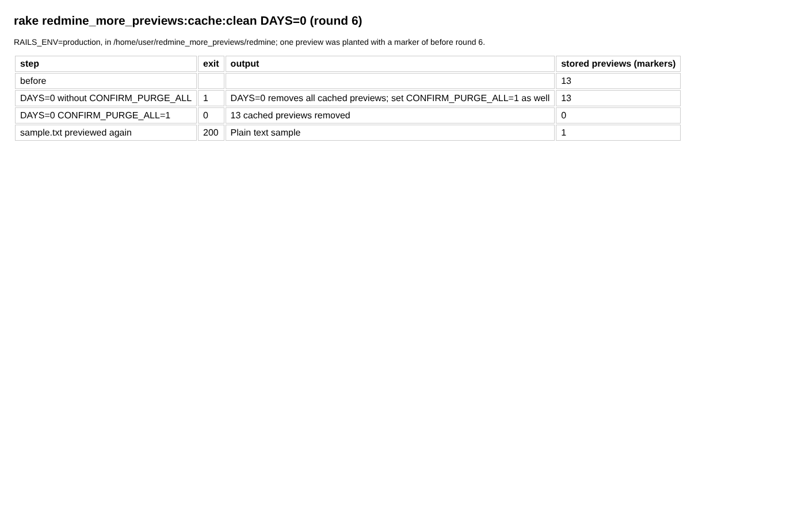

# cache_purge

Run 2026-10-29T20:45:42.092Z against http://127.0.0.1:3000.

| screenshot | user | URL | shows |
|---|---|---|---|
|  | manager | `/my/page` | DAYS=0 is refused without CONFIRM_PURGE_ALL=1; with it every stored preview goes, and a preview is converted again on the next request |
