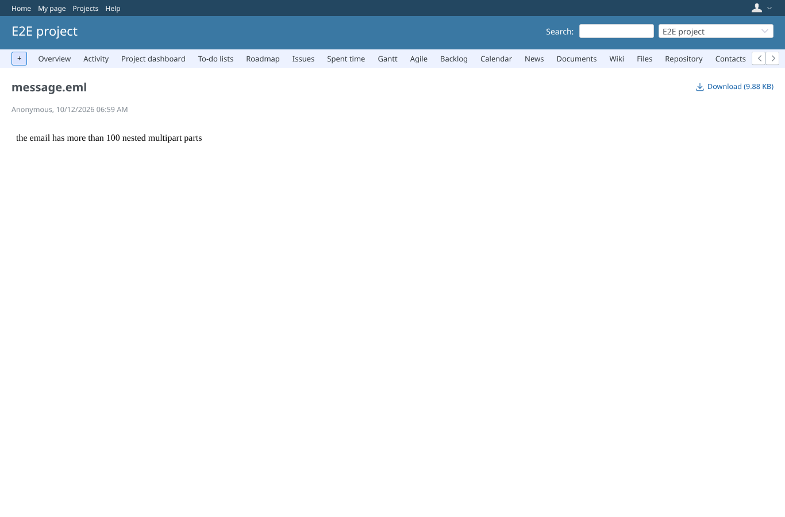
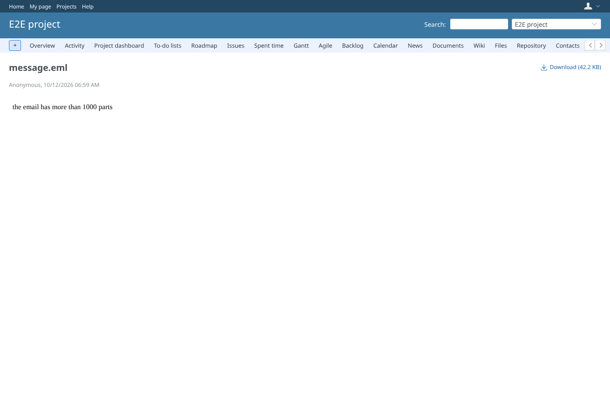
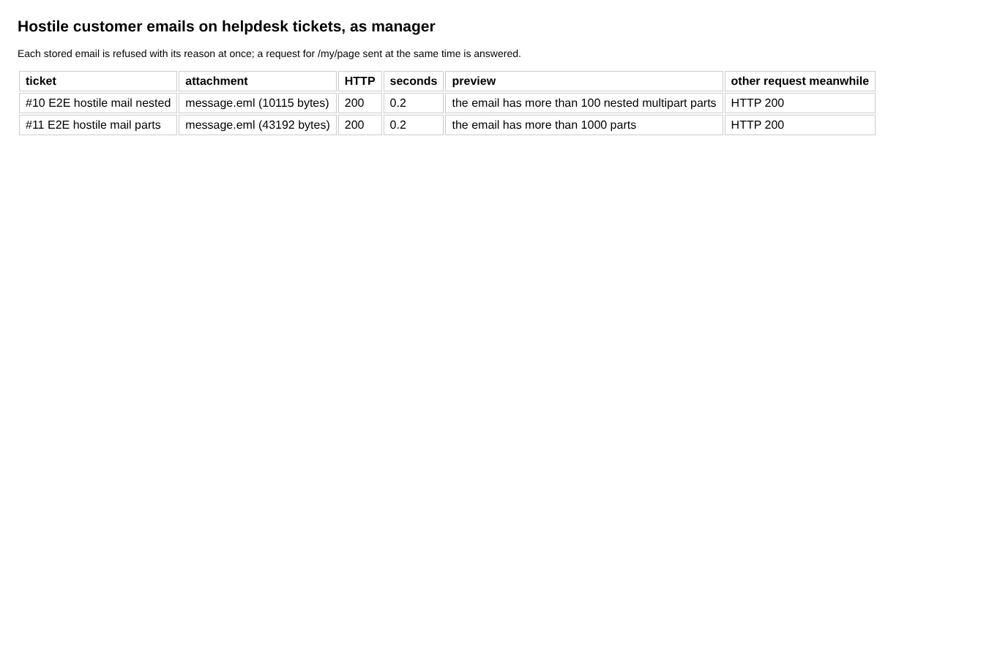
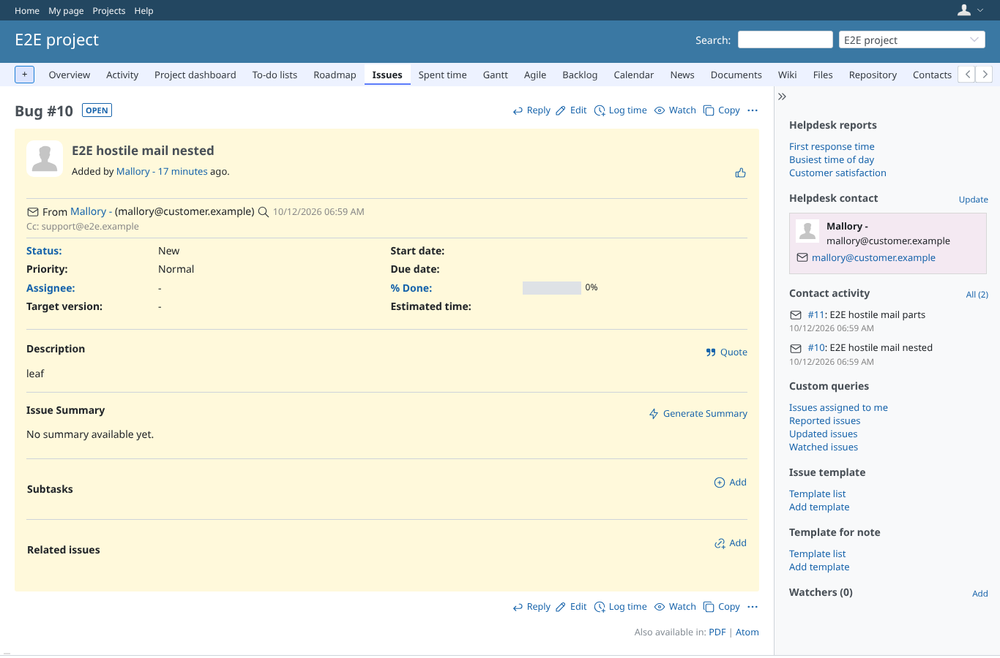

# helpdesk_mail

Run 2026-10-12T07:16:43.475Z against http://127.0.0.1:3000.

| screenshot | user | URL | shows |
|---|---|---|---|
|  | manager | `/attachments/25` | The message.eml of the helpdesk ticket "E2E hostile mail nested": the preview says why the email is not previewed |
|  | manager | `/attachments/26` | The message.eml of the helpdesk ticket "E2E hostile mail parts": the preview says why the email is not previewed |
|  | manager | `/attachments/26` | Both hostile message.eml files are refused at once, the server keeps answering |
|  | manager | `/issues/10` | The helpdesk ticket the nested hostile email created (its message.eml is stored with the ticket and previewed above) |
