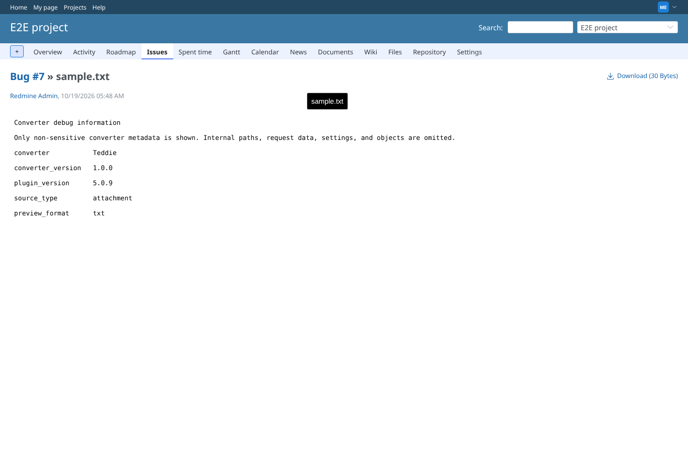
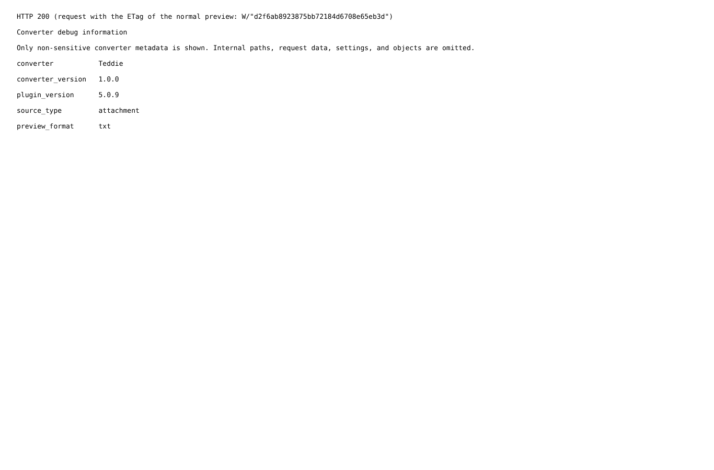
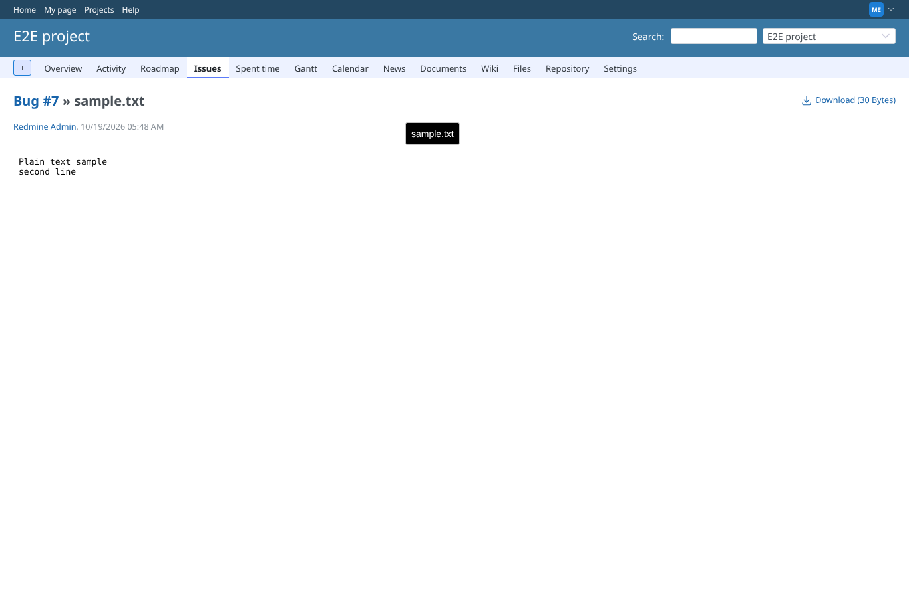

# debug_redaction

Run 2026-10-19T06:24:00.509Z against http://127.0.0.1:3000.

| screenshot | user | URL | shows |
|---|---|---|---|
|  | manager | `/attachments/13` | Debug on: the preview of sample.txt shows converter, versions, source type and format only; no path, request, settings or file content |
|  | manager | `/attachments/13` | The debug preview, answered with 200 to a browser holding the ETag of the normal preview: the whole body |
|  | manager | `/attachments/13` | Debug off: the real preview of sample.txt again |
