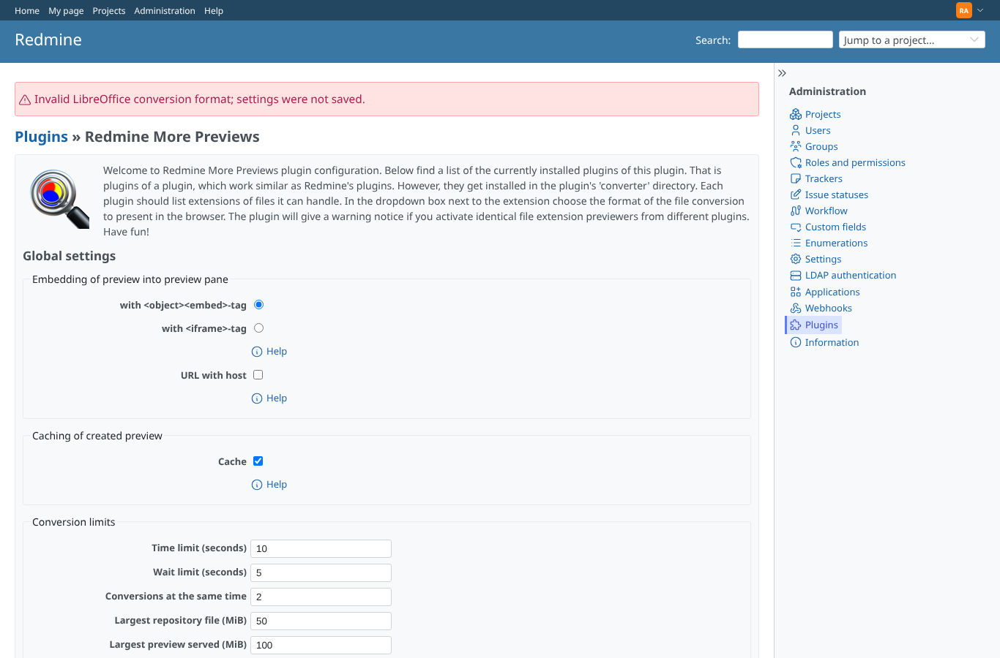
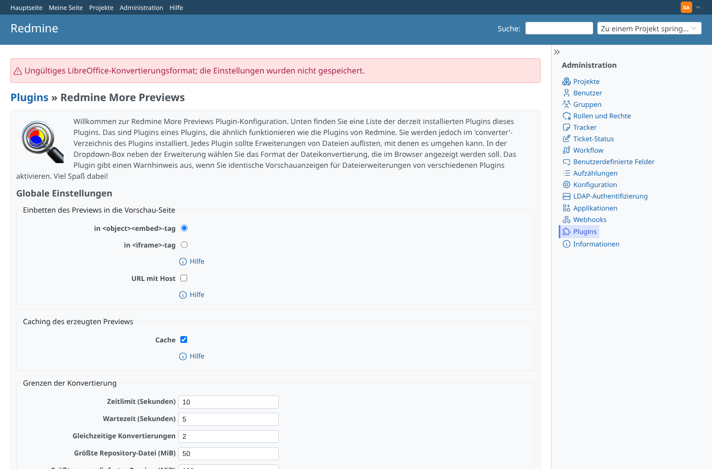
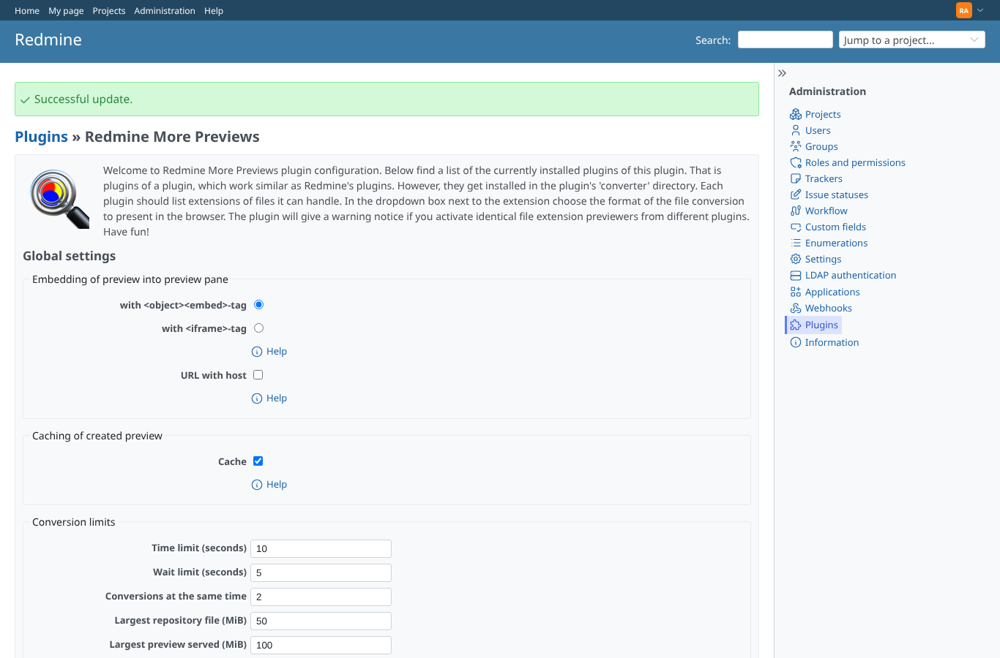

# libre_formats

Run 2026-10-19T06:20:53.525Z against http://127.0.0.1:3000.

| screenshot | user | URL | shows |
|---|---|---|---|
|  | admin | `/settings/plugin/redmine_more_previews` | docx -> "xml" (an unknown format): refused, "Invalid LibreOffice conversion format; settings were not saved.", docx stays pdf |
|  | admin | `/settings/plugin/redmine_more_previews` | docx -> "pdf;touch /tmp/e2e-pwned" (shell metacharacters): refused, "Invalid LibreOffice conversion format; settings were not saved.", docx stays pdf |
|  | admin | `/settings/plugin/redmine_more_previews` | The same refusal for a German-speaking administrator: "Ungültiges LibreOffice-Konvertierungsformat; die Einstellungen wurden nicht gespeichert." |
|  | admin | `/settings/plugin/redmine_more_previews` | A format the file type offers (docx -> html) is saved as before |
