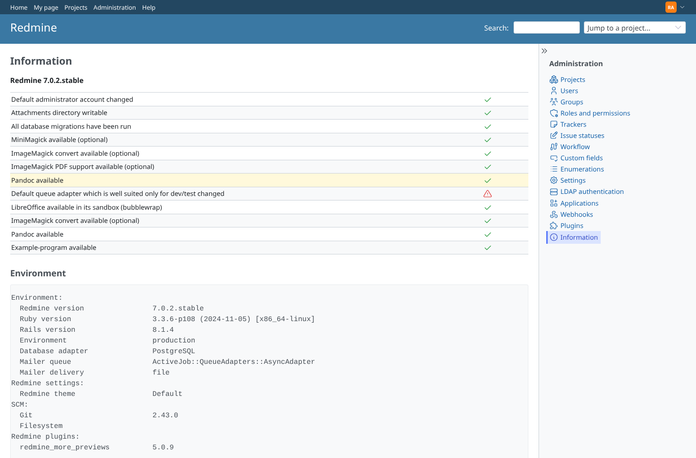
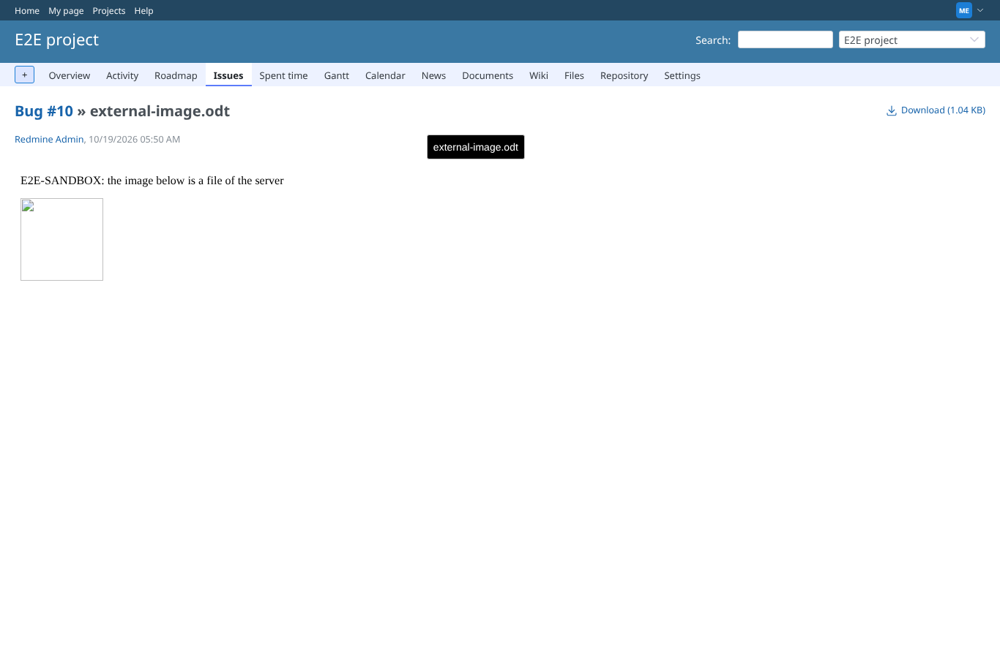
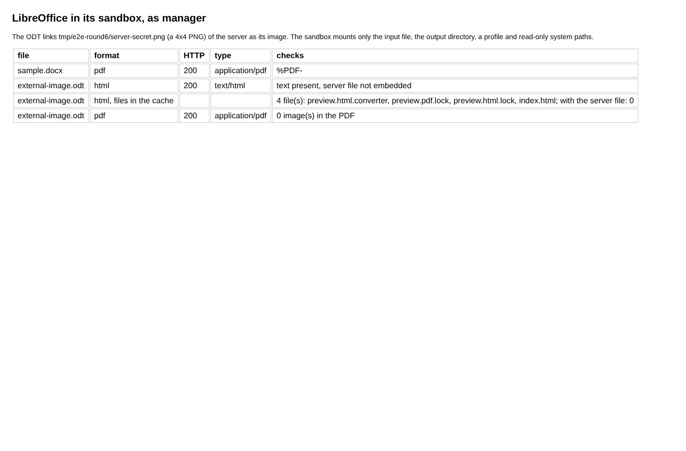
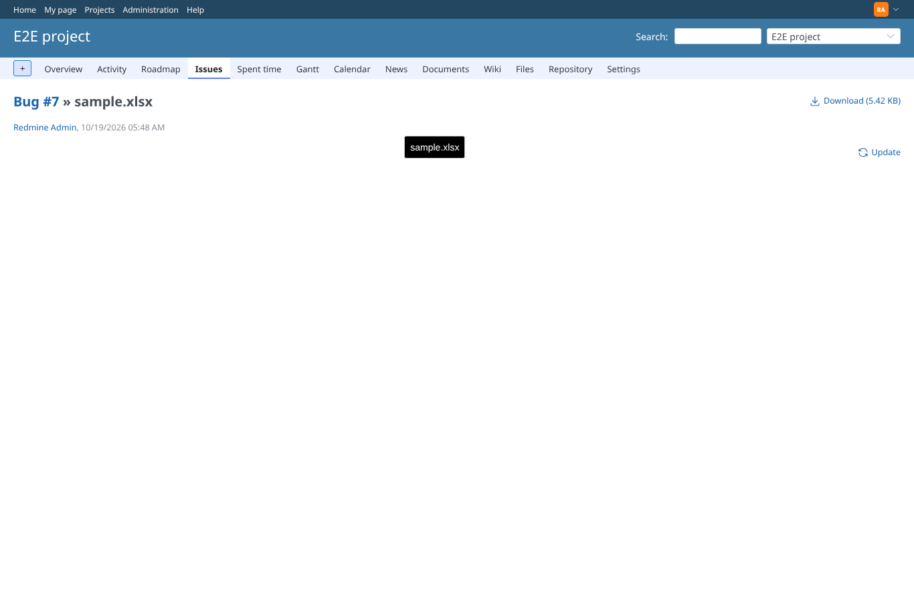
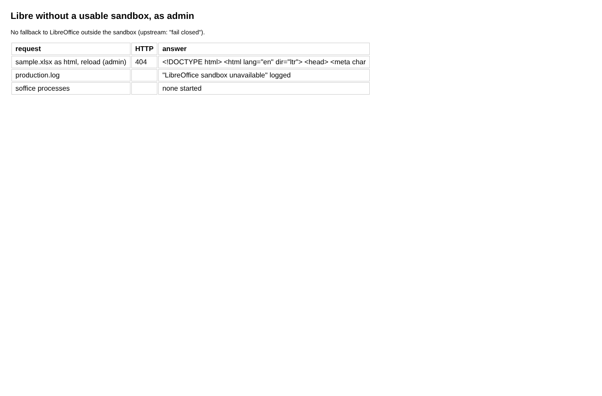

# libre_sandbox

Run 2026-10-19T06:20:40.683Z against http://127.0.0.1:3000.

| screenshot | user | URL | shows |
|---|---|---|---|
|  | admin | `/admin/info` | Administration > Information: "LibreOffice available in its sandbox (bubblewrap)" is checked on this host (bwrap 0.9.0, unprivileged namespaces work) |
|  | manager | `/attachments/25` | external-image.odt previewed as HTML by LibreOffice in its sandbox: the text is there, the linked file of the server is not (a broken image at most) |
|  | manager | `/attachments/25` | docx -> pdf and odt -> html/pdf convert in the sandbox; neither the HTML, nor the files stored with it, nor the PDF (pdfimages -list) hold the server file |
|  | admin | `/admin/info` | With /usr/bin/bwrap not executable the check fails: Libre will not convert |
|  | admin | `/attachments/15` | The page of sample.xlsx without the sandbox: the preview frame stays empty (404), nothing was converted |
|  | admin | `/attachments/15` | Without bwrap Libre answers 404 and logs why; no soffice runs |
