# limits

Run 2026-10-29T20:49:01.455Z against http://127.0.0.1:3000.

| screenshot | user | URL | shows |
|---|---|---|---|
| 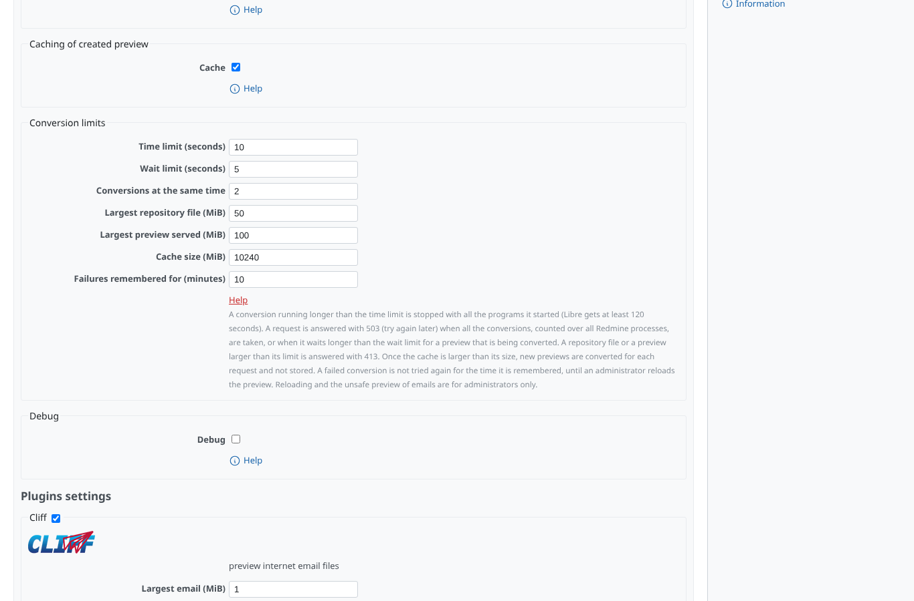 | admin | `/settings/plugin/redmine_more_previews` | Settings > Plugins > More previews: the conversion limits (time limit 10 s for the e2e run, the others at their defaults) with the help text opened |
| 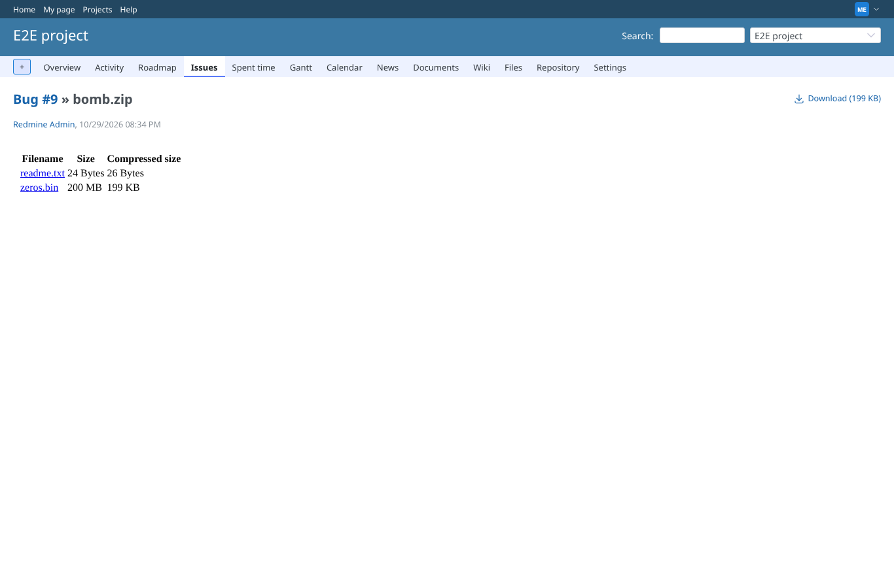 | manager | `/attachments/18` | bomb.zip: the listing works; zeros.bin unpacks to 200 MB (compressed to a few hundred KB) |
| 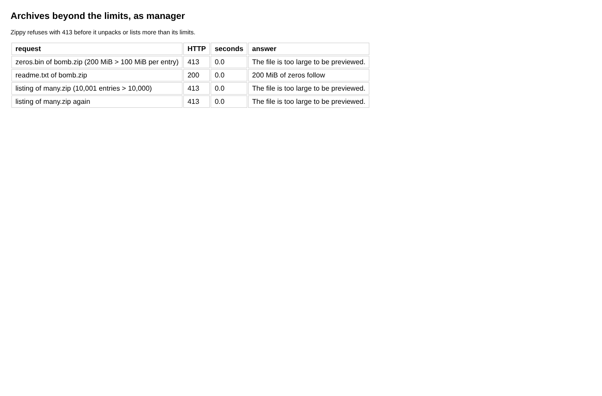 | manager | `/attachments/18` | An entry unpacking beyond 100 MiB and a zip of more than 10,000 entries are answered with 413 "The file is too large to be previewed." |
| 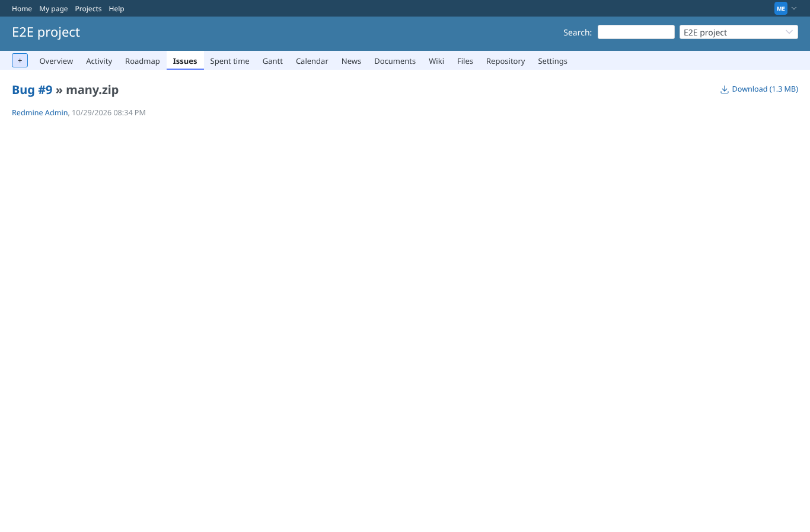 | manager | `/attachments/19` | The page of many.zip: the preview frame (an <object> with embedding 0) stays empty, the browser shows no error body of a 413 there (as for 404 and 503) |
| 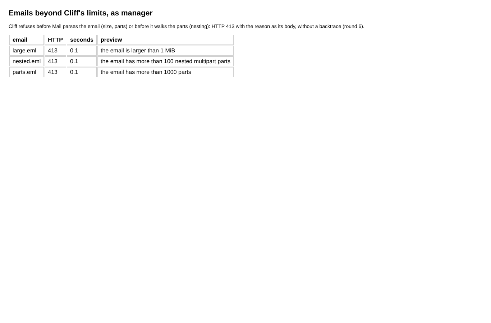 | manager | `/attachments/19` | An email above the size limit, one nested 150 levels deep and one of 1,001 parts are refused with 413 and their reason |
| 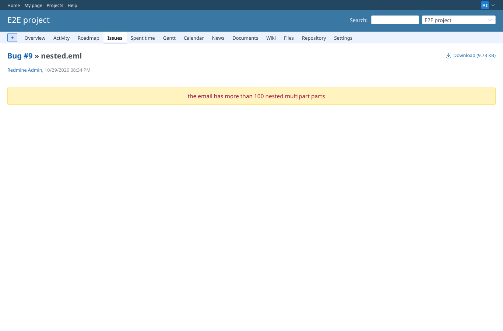 | manager | `/attachments/21` | The page of nested.eml: a warning above the empty preview frame (413) says why the email is not previewed |
| 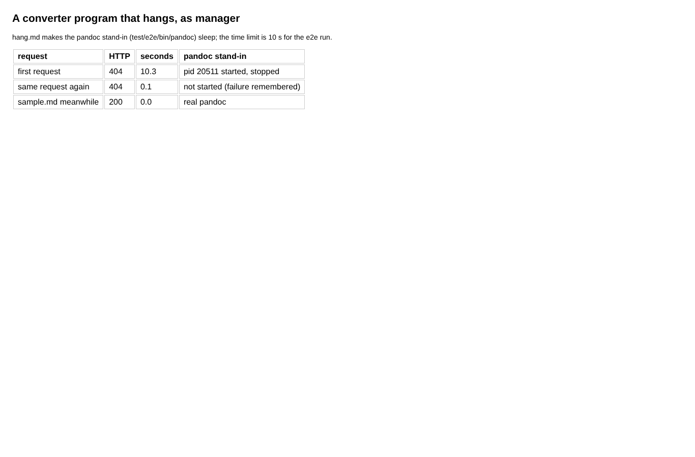 | manager | `/attachments/21` | The hanging conversion is stopped with its process after the 10 s time limit (404); the same request is answered at once afterwards, without starting pandoc again |
| 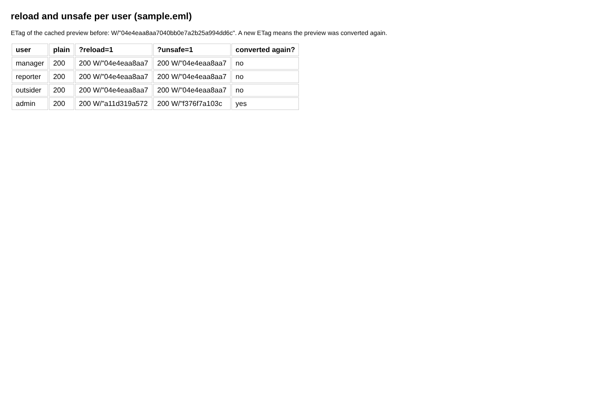 | admin | `/my/page` | reload and unsafe take effect for the administrator only; for manager, reporter and outsider the request is served as without them |
| 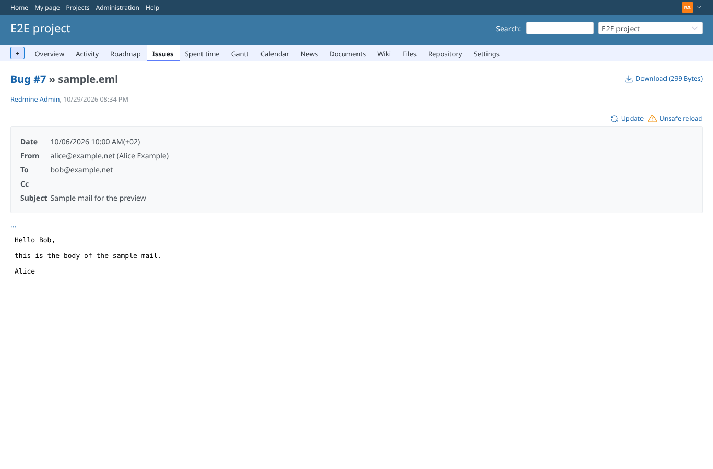 | admin | `/attachments/4` | As administrator the email page offers "Update" and Cliff's unsafe reload |
| 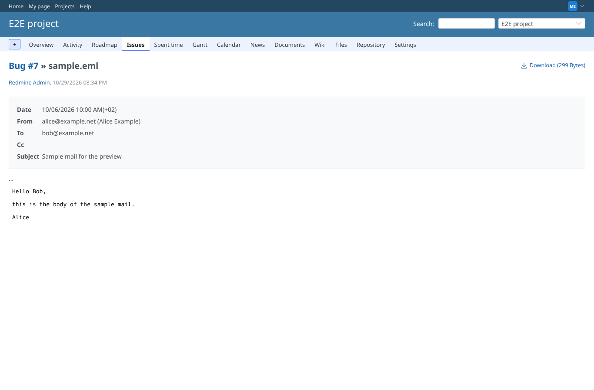 | manager | `/attachments/4` | As manager (every permission of the project) the same page has neither link |
| 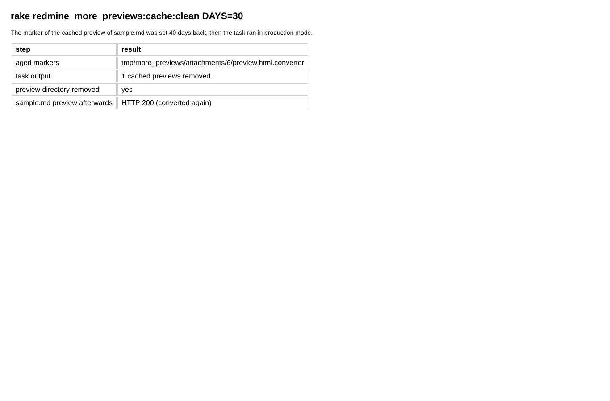 | manager | `/attachments/4` | The cache rake task removes previews cached more than DAYS days ago; the next request converts the file again |
| 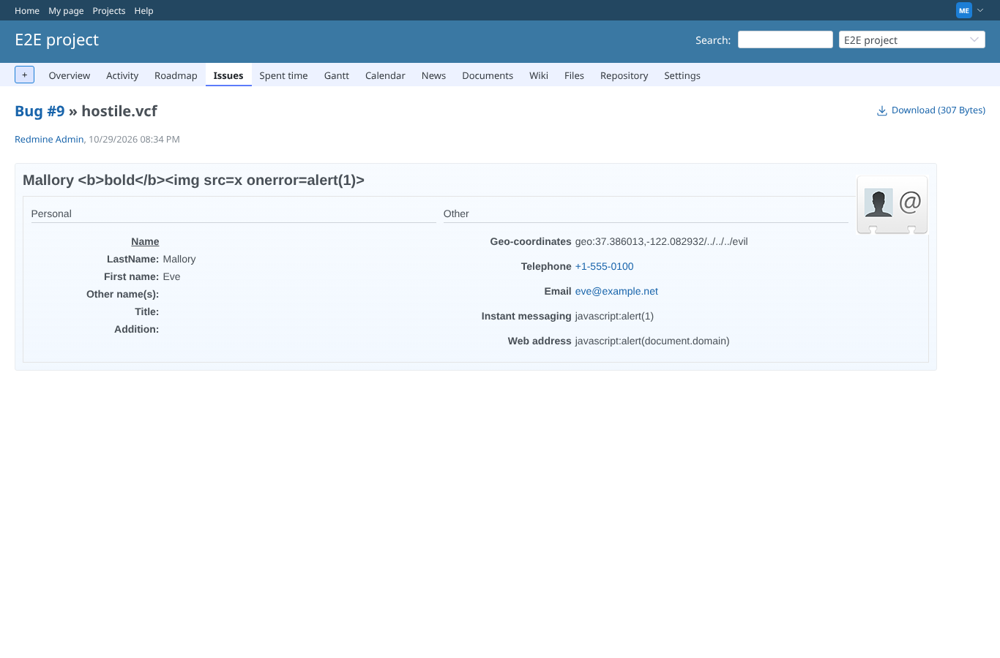 | manager | `/attachments/24` | hostile.vcf: the name with HTML is shown as text, the javascript: URL and IMPP are text, the GEO value with an injected path is no map link, the file: photo is not rendered |
