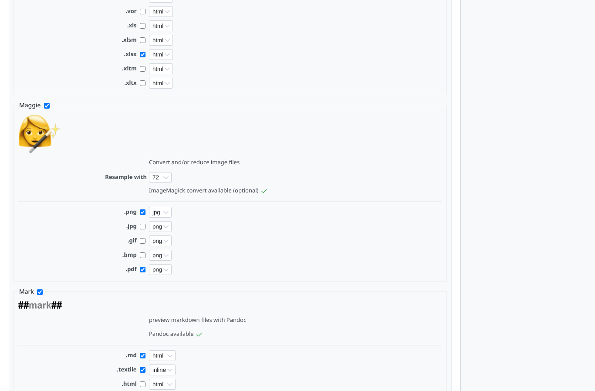
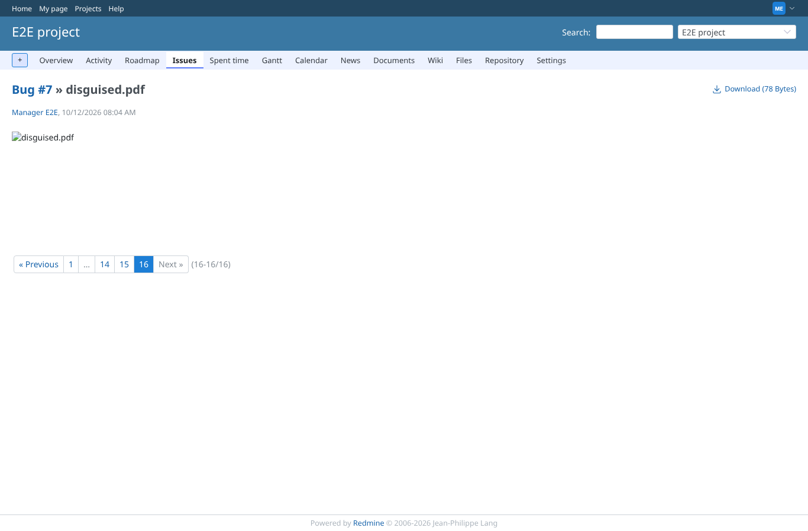
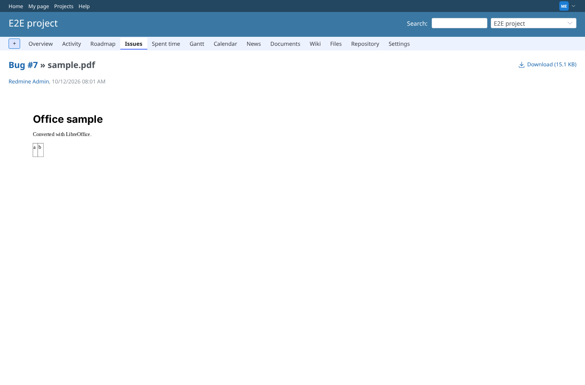
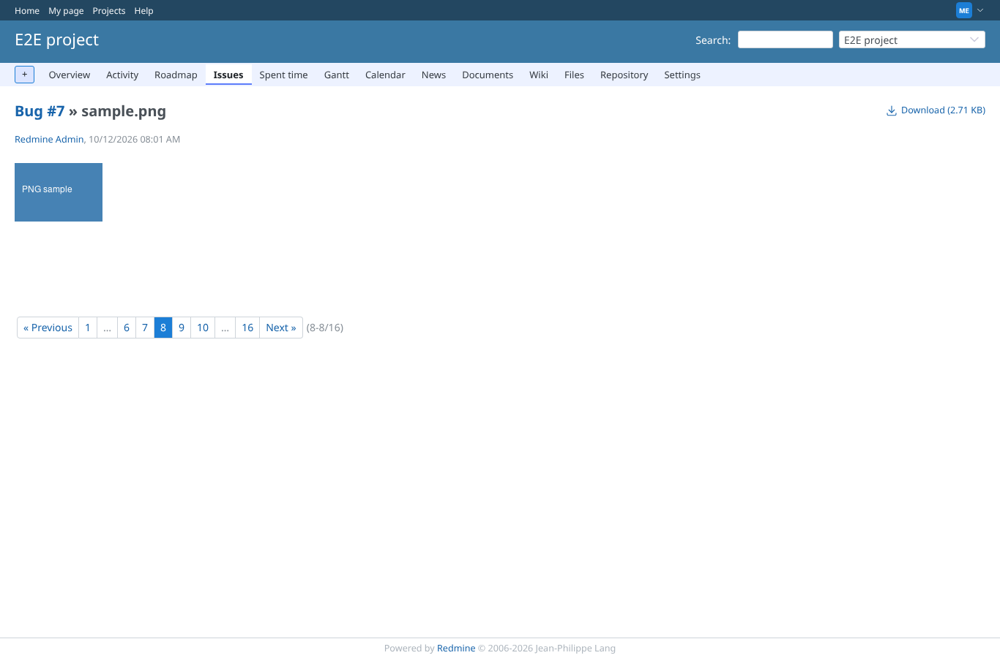
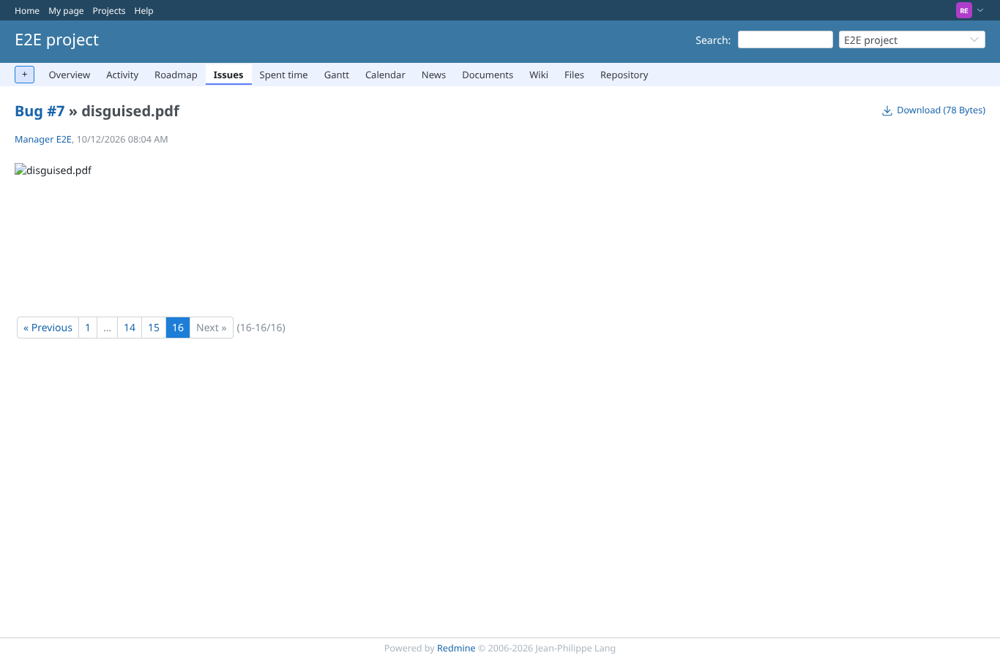
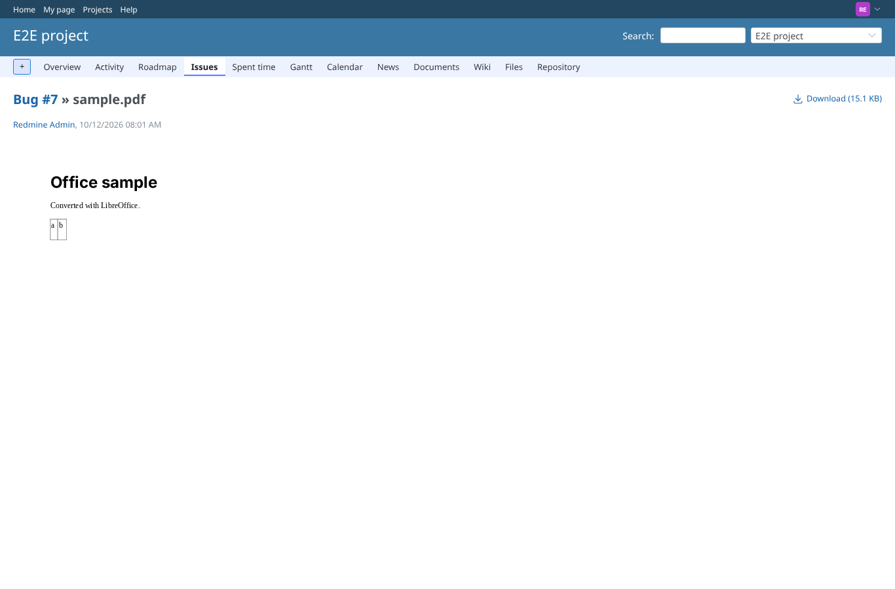
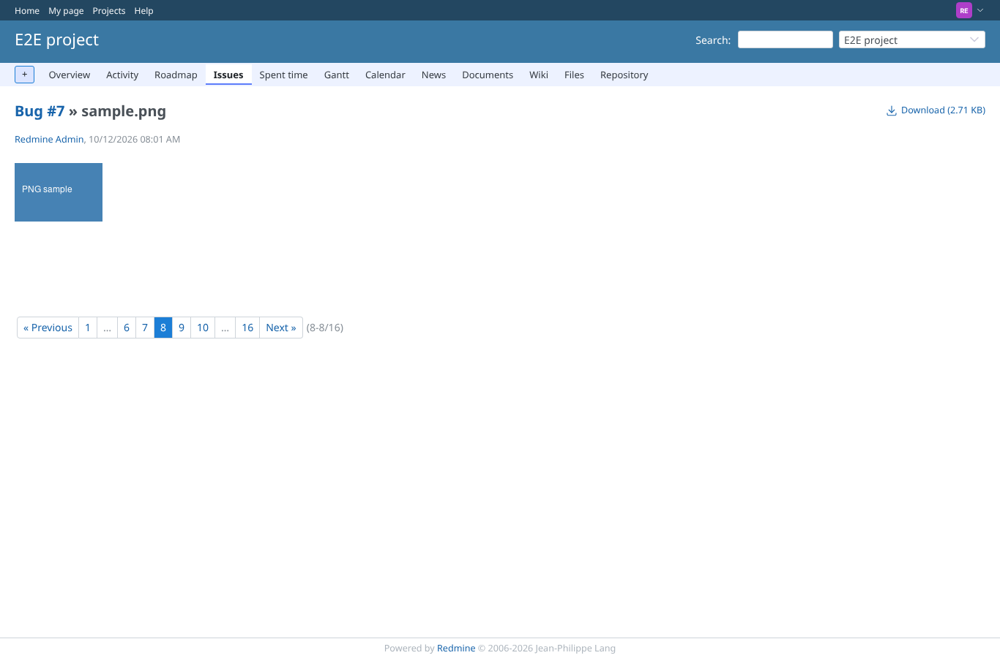

# maggie

Run 2026-10-12T08:04:55.579Z against http://127.0.0.1:3000.

| screenshot | user | URL | shows |
|---|---|---|---|
|  | admin | `/settings/plugin/redmine_more_previews` | Maggie turned on for .pdf (to png) and .png (to jpg), Peek off for .pdf |
|  | manager | `/attachments/25` | manager: disguised.pdf gets no preview: PostScript disguised as a PDF never reaches ImageMagick |
|  | manager | `/attachments/8` | manager: sample.pdf still converted by Maggie |
|  | manager | `/attachments/9` | manager: sample.png still converted by Maggie |
|  | manager | `/attachments/9` | manager: the disguised PDF returns no image, the real PDF a PNG, the PNG a JPEG |
|  | reporter | `/attachments/25` | reporter: disguised.pdf gets no preview: PostScript disguised as a PDF never reaches ImageMagick |
|  | reporter | `/attachments/8` | reporter: sample.pdf still converted by Maggie |
|  | reporter | `/attachments/9` | reporter: sample.png still converted by Maggie |
|  | reporter | `/attachments/9` | reporter: the disguised PDF returns no image, the real PDF a PNG, the PNG a JPEG |
|  | outsider | `/attachments/25` | outsider (non-member, public project): same result, no preview of the disguised PDF |
