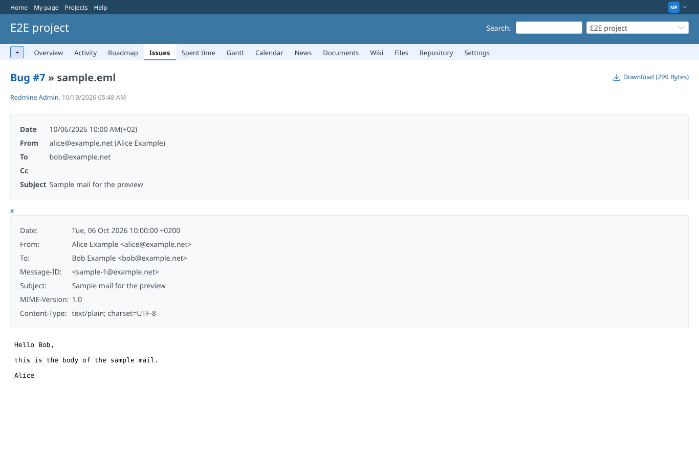
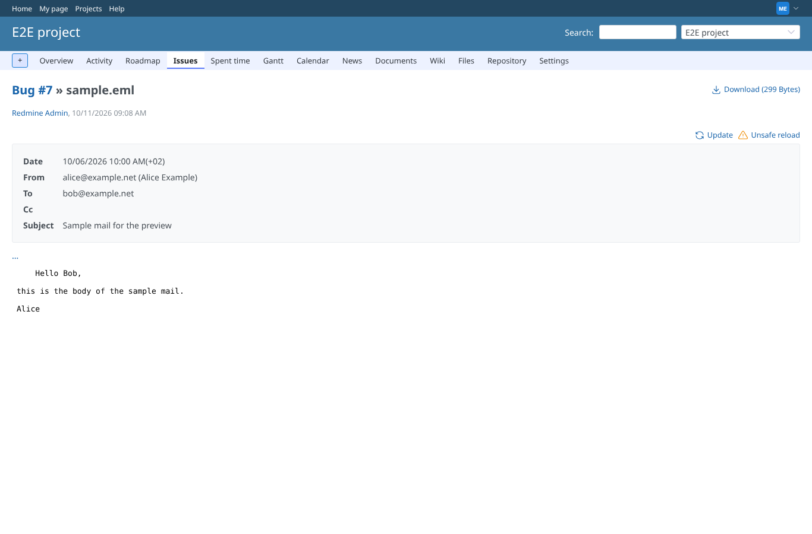
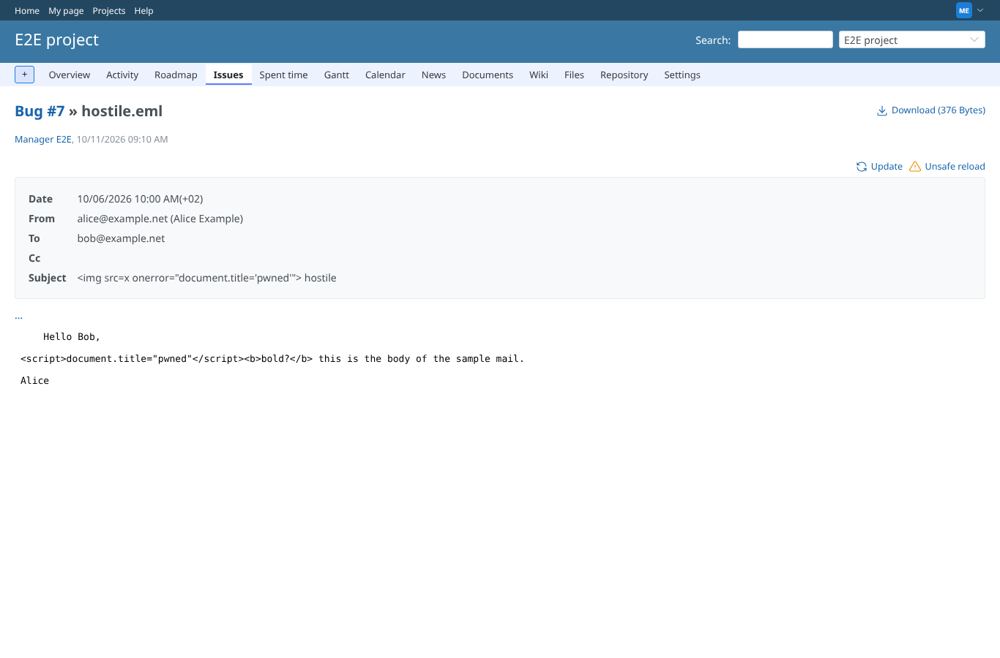

# mail

Run 2026-10-19T06:21:52.758Z against http://127.0.0.1:3000.

| screenshot | user | URL | shows |
|---|---|---|---|
|  | manager | `/attachments/4` | Mail preview as manager: header box, all header fields opened with "...", the body below; no Update or Unsafe reload (administrators only since round 5) |
|  | admin | `/attachments/4?reload=1&unsafe=1` | As administrator, "Unsafe reload" converts the mail again without the cache |
|  | manager | `/attachments/31` | A mail with  in the subject and <script> in the body: both shown as text, nothing runs (the page title stays) |
