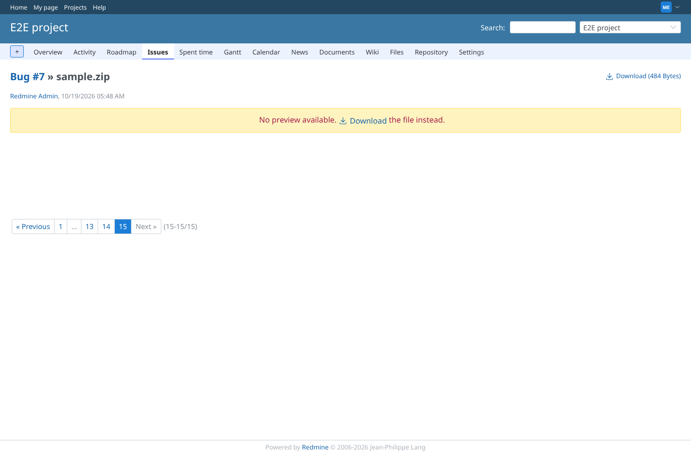
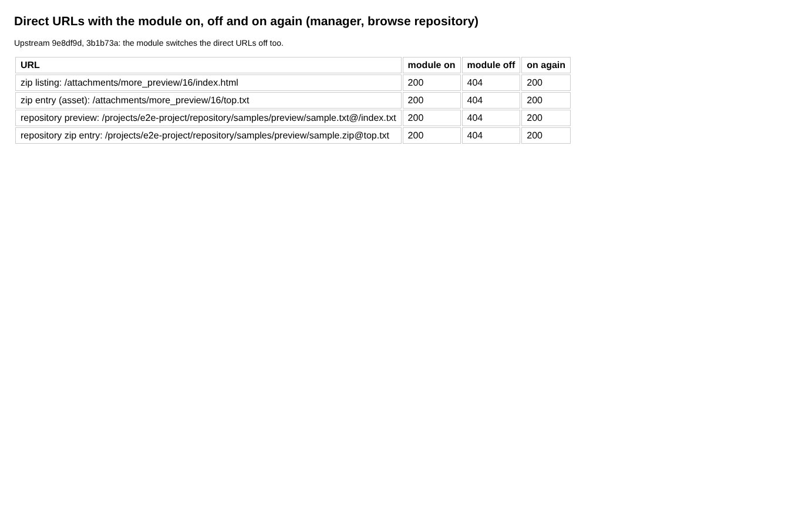

# module_off

Run 2026-10-19T06:23:44.972Z against http://127.0.0.1:3000.

| screenshot | user | URL | shows |
|---|---|---|---|
|  | manager | `/attachments/16` | Module off: the attachment page is Redmine's own (no plugin preview pane) |
|  | manager | `/my/page` | The preview and asset URLs answer 404 while the module is off, 200 when it is on |
