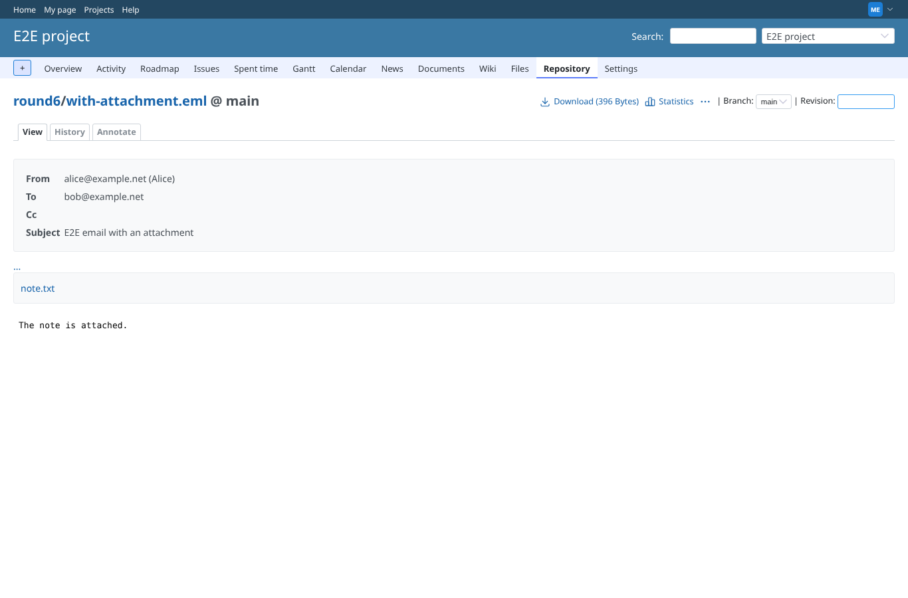
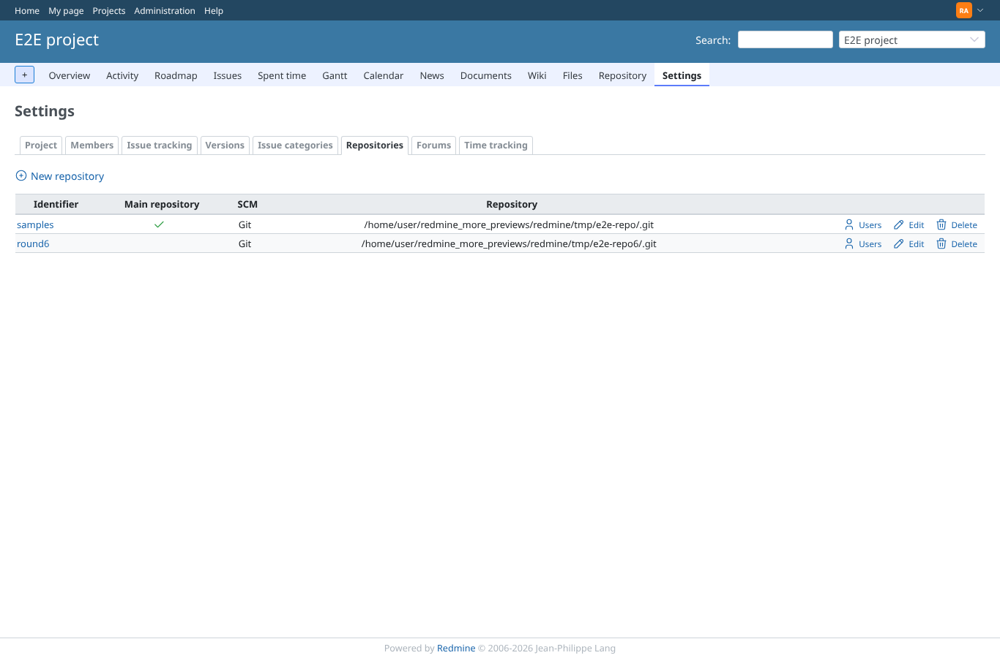
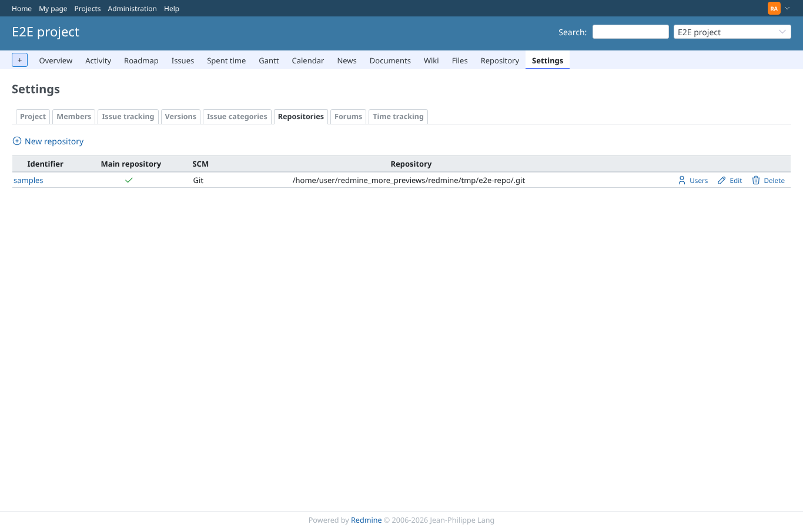

# repository_delete

Run 2026-10-29T20:50:41.604Z against http://127.0.0.1:3000.

| screenshot | user | URL | shows |
|---|---|---|---|
|  | manager | `/projects/e2e-project/repository/round6/entry/with-attachment.eml` | with-attachment.eml at the top of the repository: the attachment note.txt links to /projects/e2e-project/repository/round6/main/preview/with-attachment.eml@note.txt (HTTP 200) |
|  | admin | `/projects/e2e-project/settings/repositories` | Project settings > Repositories: "round6" (id 2) is about to be deleted; its previews are in tmp/more_previews/repository/gits/2 |
|  | admin | `/projects/e2e-project/settings/repositories` | The repository "round6" is deleted |
|  | admin | `/projects/e2e-project/settings/repositories` | Its previews are removed with it, the other repository's stay |
