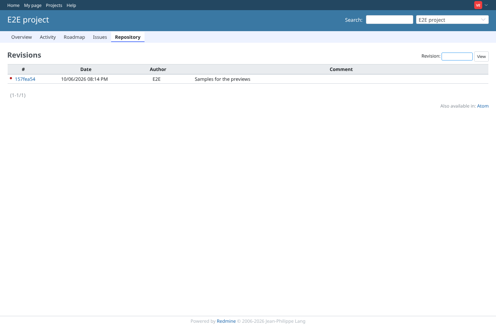
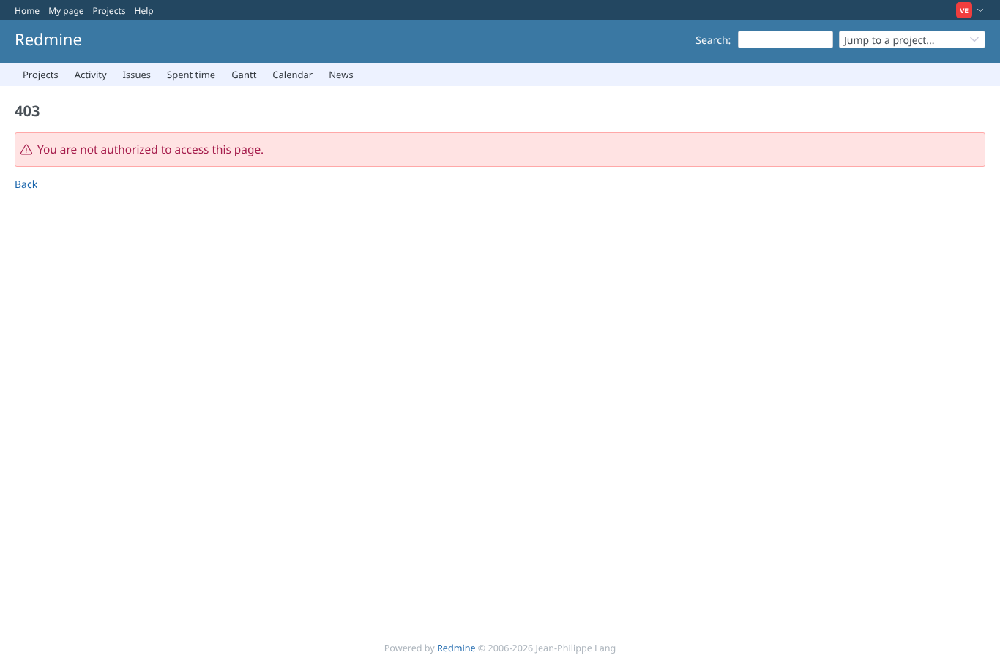
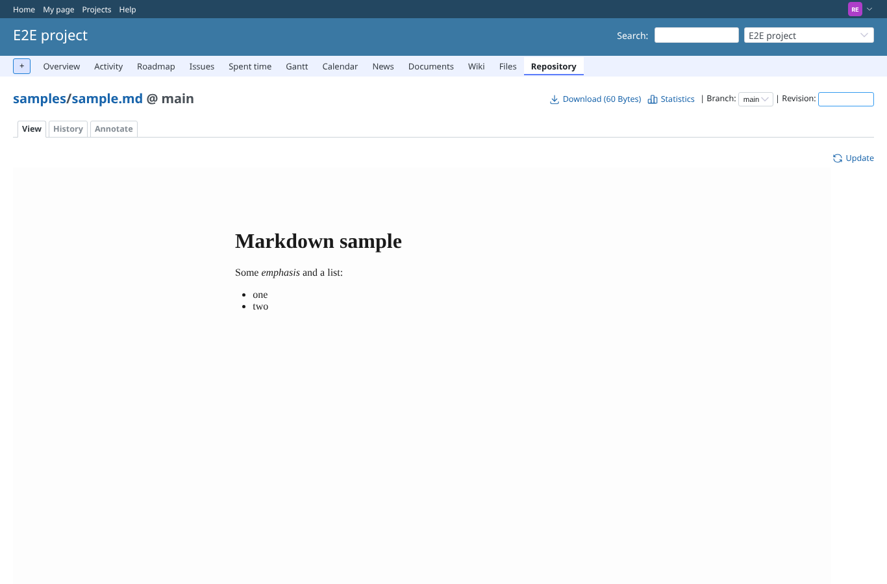
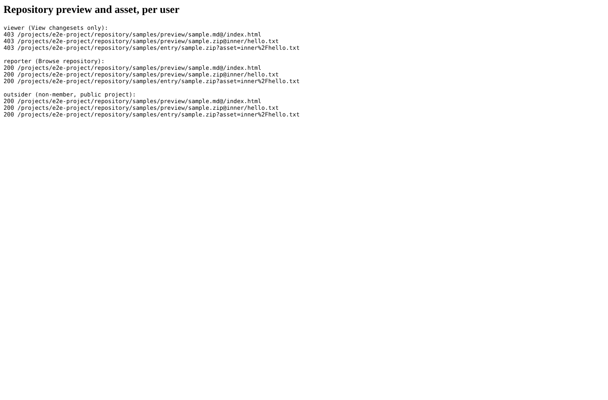
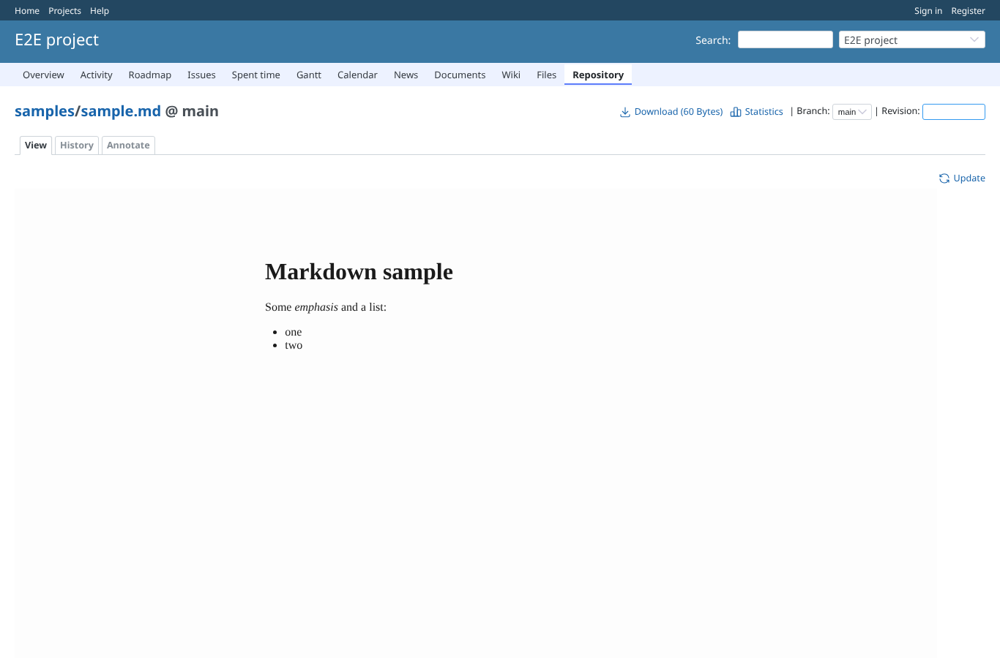

# repository_permissions

Run 2026-10-11T09:11:49.574Z against http://127.0.0.1:3000.

| screenshot | user | URL | shows |
|---|---|---|---|
|  | viewer | `/projects/e2e-project/repository/samples/revisions` | viewer has "View changesets": the revisions of the repository are shown |
|  | viewer | `/projects/e2e-project/repository/samples/entry/sample.md` | viewer without "Browse repository": the file page is refused by core (403) |
|  | reporter | `/projects/e2e-project/repository/samples/entry/sample.md` | reporter (Browse repository): the markdown preview of the repository file is shown |
|  | outsider | `/my/page` | Preview and asset URLs: 403 for viewer (it used to get the file through view_changesets), 200 for reporter and outsider |
|  | anonymous | `/projects/e2e-project/repository/samples/entry/sample.md` | Anonymous on the public project: core lets it browse the repository (default Anonymous role), so the preview is shown too |
