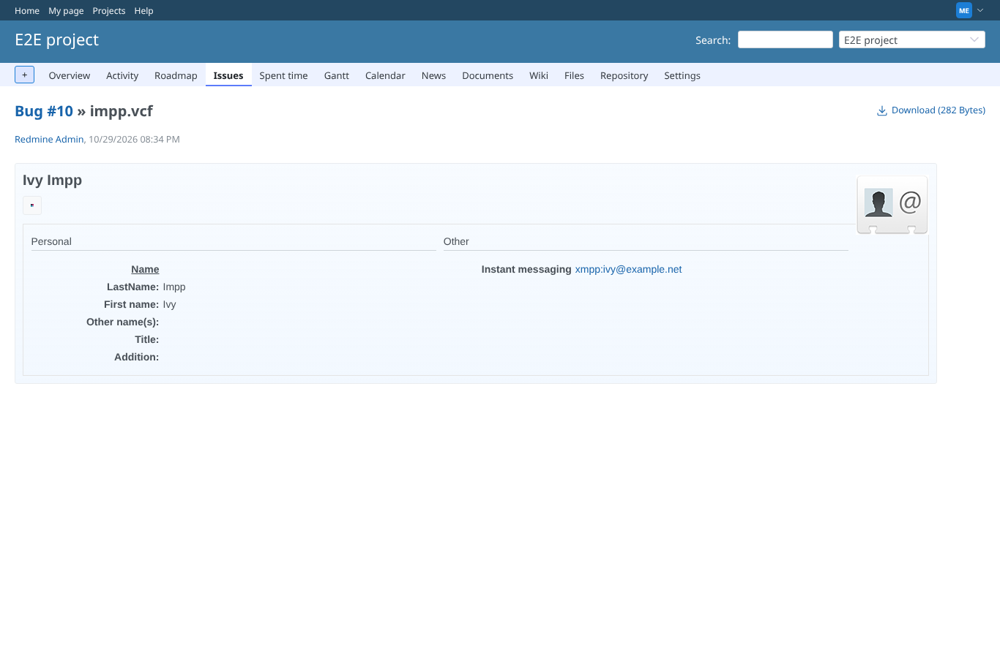
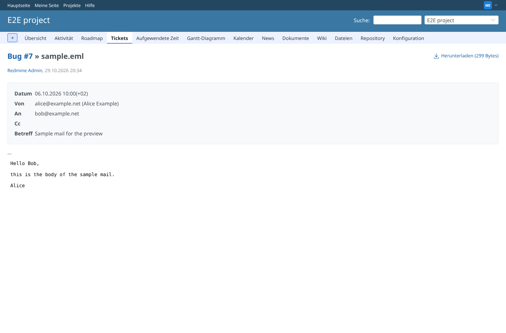
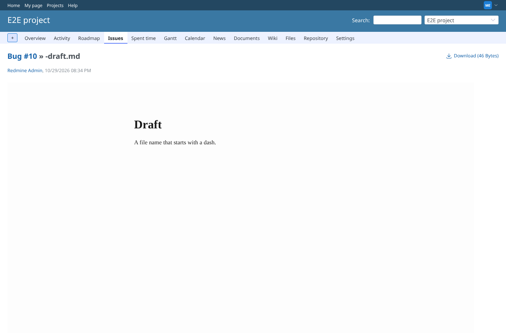
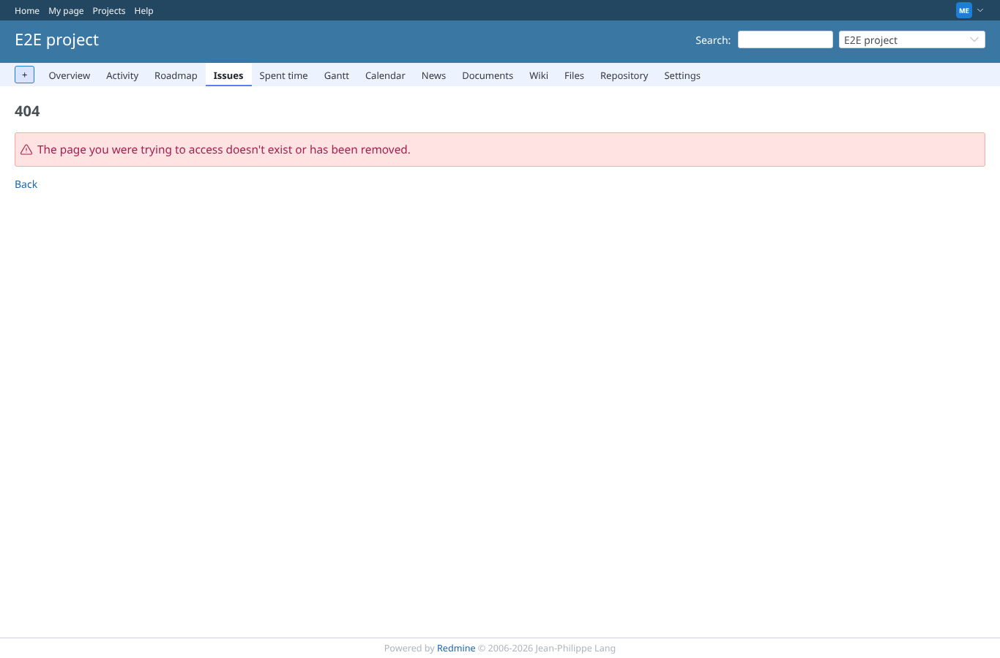

# round6_files

Run 2026-10-29T20:51:10.920Z against http://127.0.0.1:3000.

| screenshot | user | URL | shows |
|---|---|---|---|
|  | manager | `/attachments/26` | impp.vcf: the IMPP address is labelled "Instant messaging" (it read "Translation missing" before); the photo carries alt="Photo" |
|  | manager | `/attachments/4` | sample.eml as a German-speaking user: the labels (Datum, Von, An, Cc, Betreff) stay on one line |
|  | manager | `/attachments/28` | -draft.md is previewed by Mark (pandoc); before, "mv -draft.html ..." took the name for an option and the preview was empty |
|  | manager | `/attachments/27` | gone.txt with its file removed from disk: the page and the preview URLs answer 404 (/attachments/more_preview/27/index.txt: 404; /attachments/more_preview/27/index.txt?reload=1: 404), as Redmine's own download |
