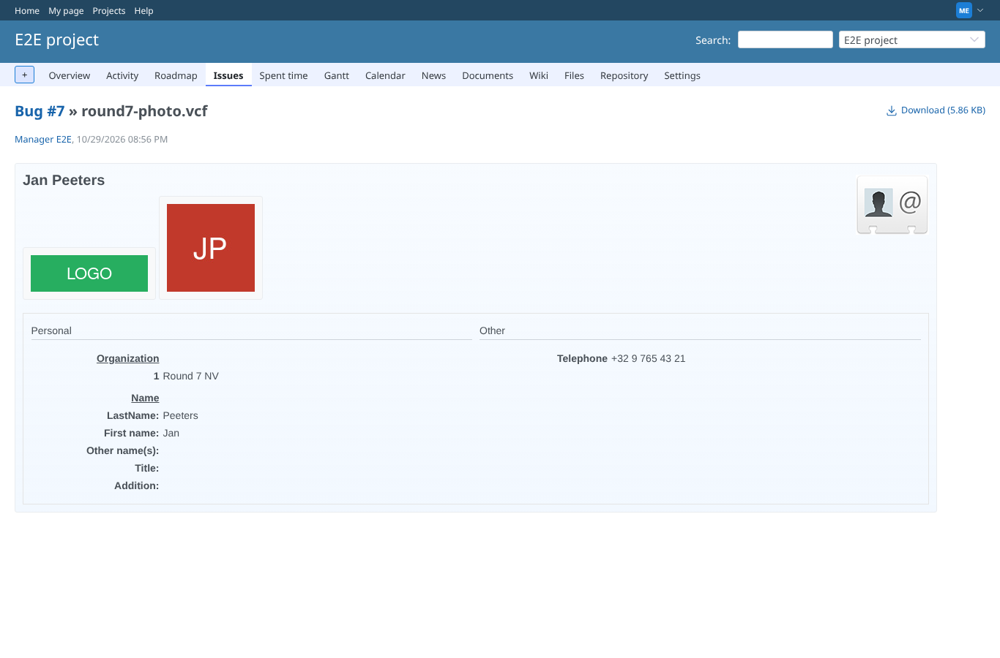
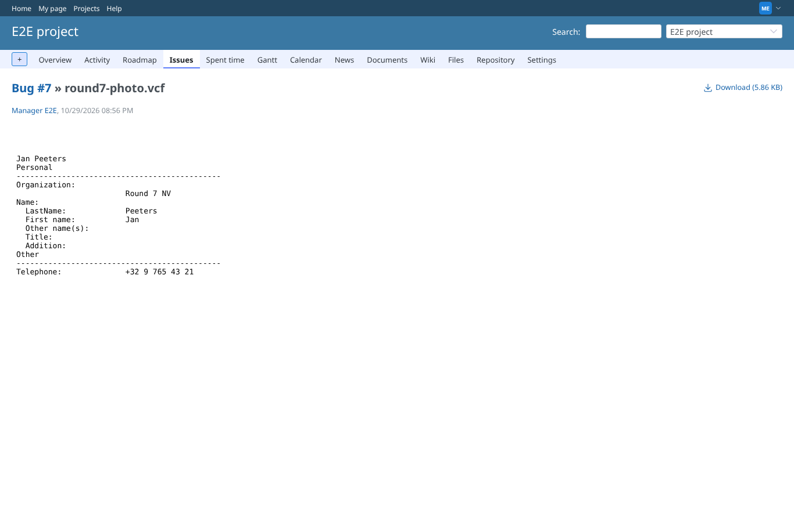
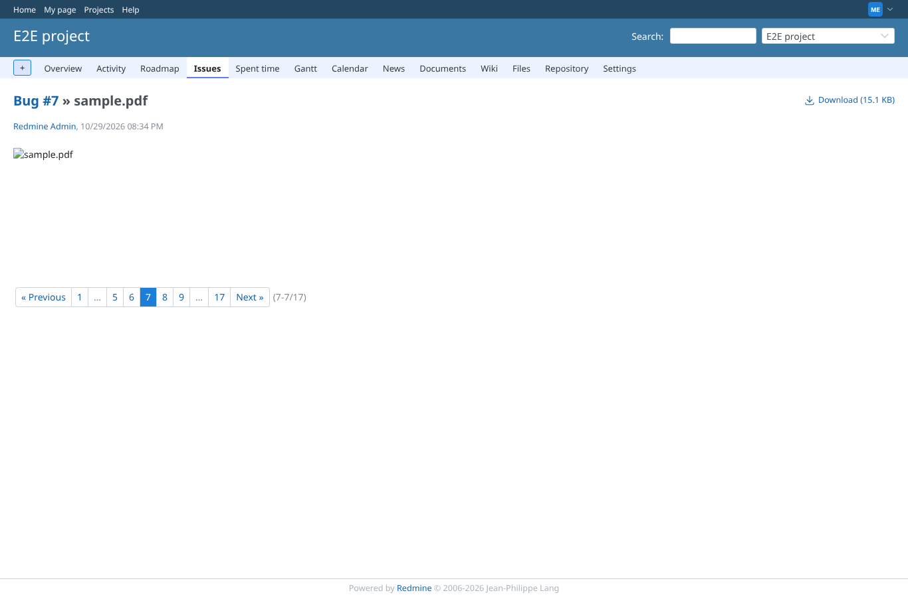
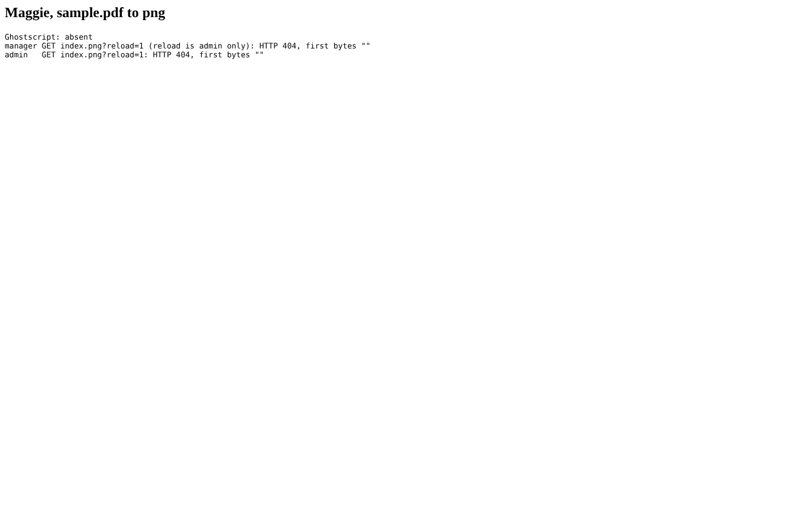
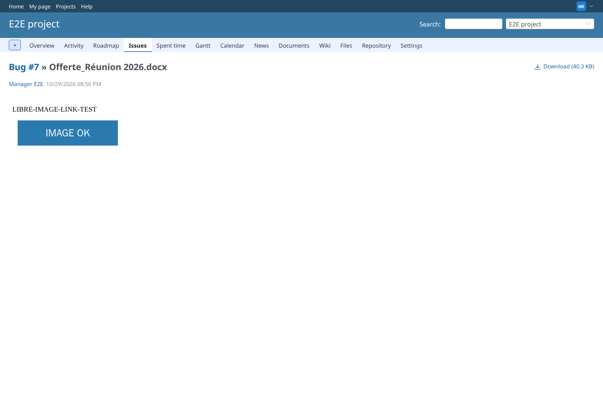
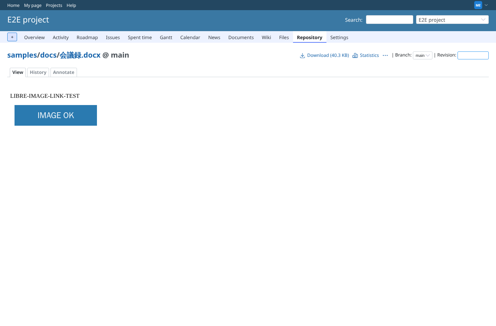
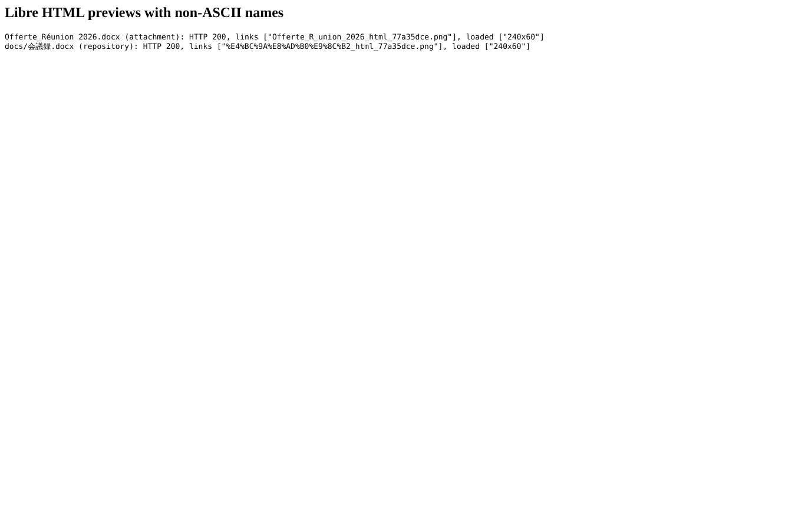
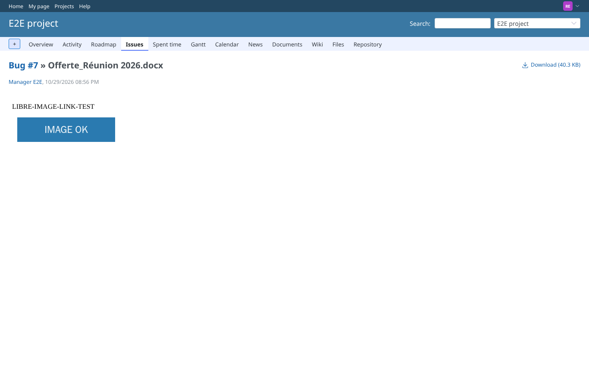

# round7

Run 2026-10-29T20:57:17.254Z against http://127.0.0.1:3000.

| screenshot | user | URL | shows |
|---|---|---|---|
|  | manager | `/attachments/47` | round7-photo.vcf (vCard 3.0) as HTML: PHOTO TYPE=JPEG and LOGO TYPE=png shown, as data:image/png and data:image/jpeg |
|  | manager | `/attachments/47` | round7-photo.vcf as text: HTTP 200, name and phone shown (PHOTO/LOGO are not in the text template) |
|  | manager | `/attachments/8` | sample.pdf by Maggie to png, Ghostscript absent: index.png answers HTTP 404 (no fake PNG) |
|  | admin | `/my/page` | Maggie, sample.pdf to png |
|  | manager | `/attachments/48` | Offerte_Réunion 2026.docx (attachment) as HTML by LibreOffice (sandbox): the image is shown; link Offerte_R_union_2026_html_77a35dce.png |
|  | manager | `/projects/e2e-project/repository/samples/entry/docs/%E4%BC%9A%E8%AD%B0%E9%8C%B2.docx` | docs/会議録.docx (repository) as HTML by LibreOffice (sandbox): the image is shown; link %E4%BC%9A%E8%AD%B0%E9%8C%B2_html_77a35dce.png |
|  | manager | `/projects/e2e-project/repository/samples/entry/docs/%E4%BC%9A%E8%AD%B0%E9%8C%B2.docx` | Libre HTML previews with non-ASCII names |
|  | reporter | `/attachments/48` | reporter (core Reporter role): the same preview, HTTP 200 |
