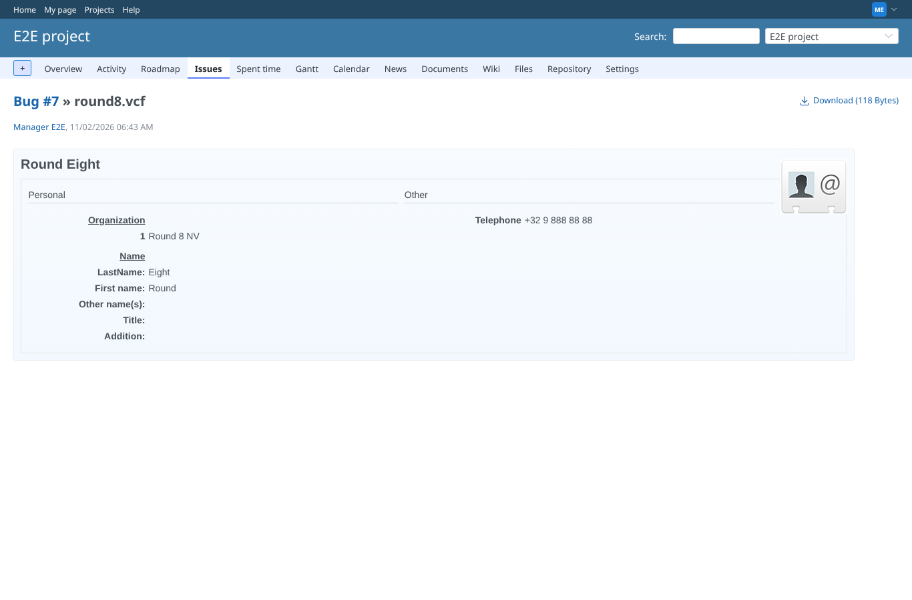
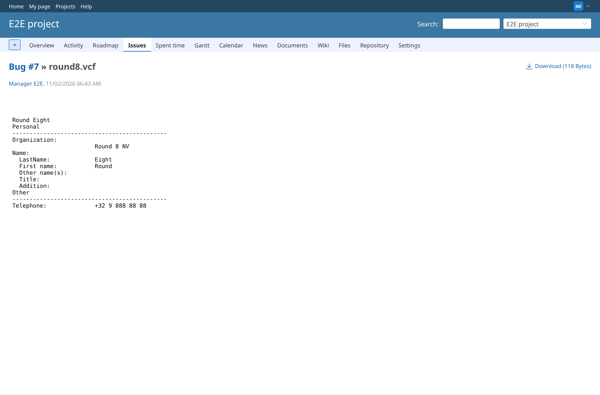
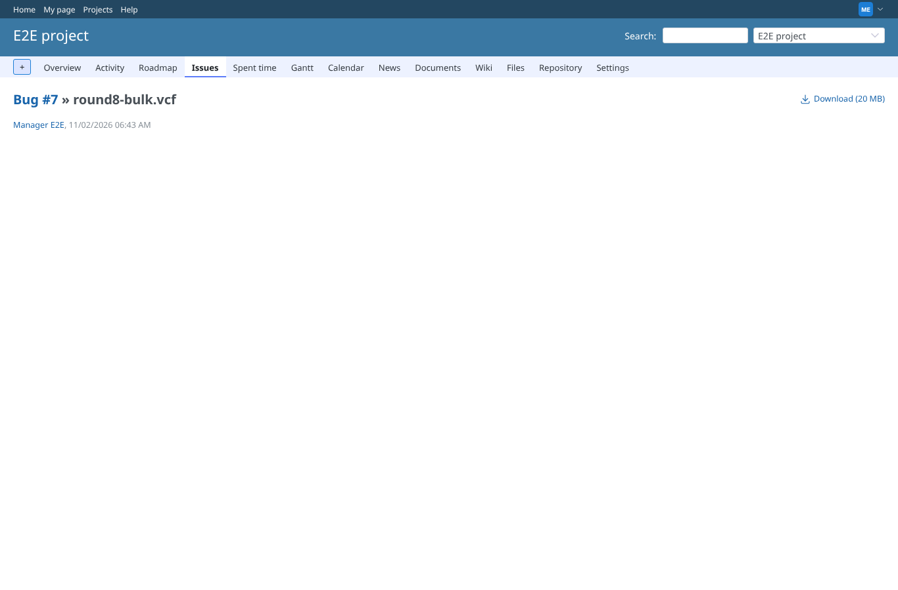
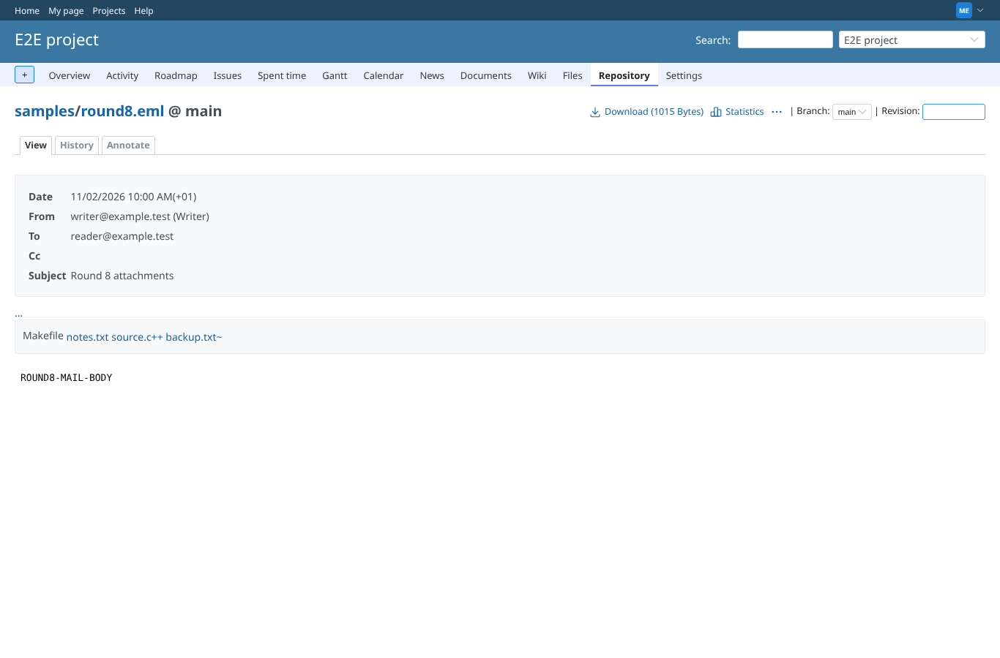
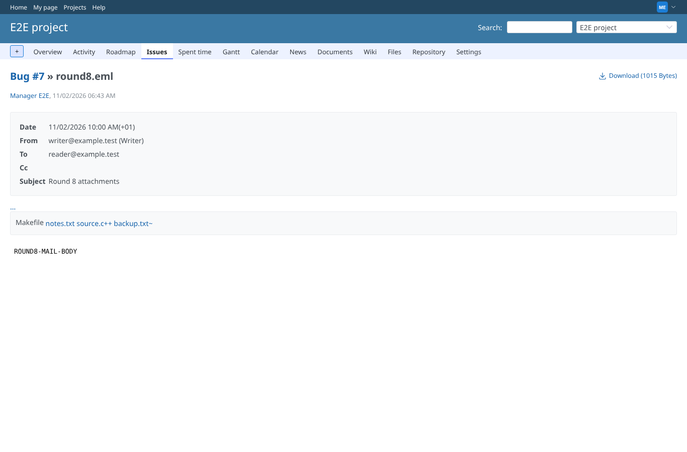
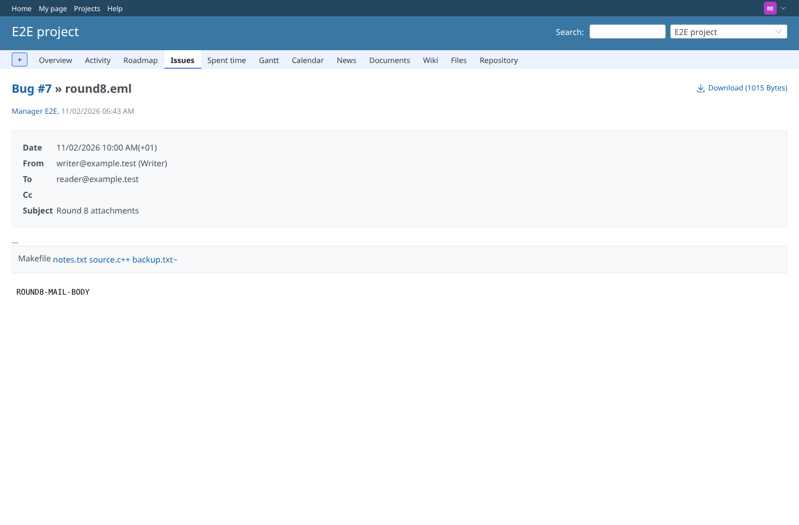
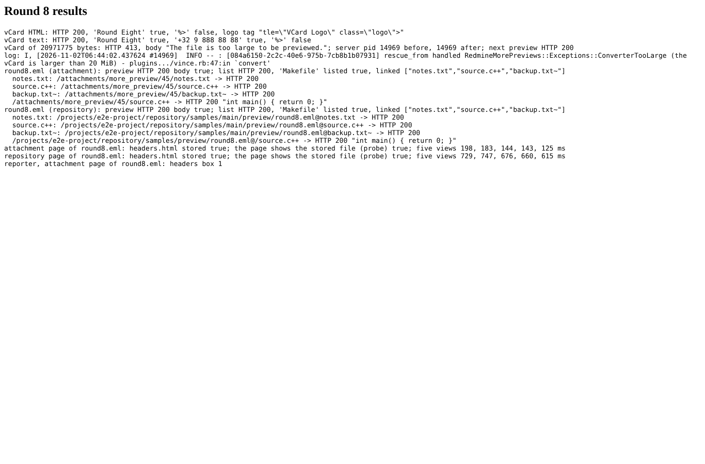

# round8

Run 2026-11-02T06:44:48.151Z against http://127.0.0.1:3000.

| screenshot | user | URL | shows |
|---|---|---|---|
|  | manager | `/attachments/43` | round8.vcf as HTML (Vince in a child process): card shown, no '%>' after the logo (HTTP 200) |
|  | manager | `/attachments/43` | round8.vcf as text: name and phone shown, no '%>' (HTTP 200) |
|  | manager | `/attachments/44` | round8-bulk.vcf, 20.0 MiB: refused with 413 before forking; the server (pid 14969) still answers. The page shows no preview and no reason (a browser shows nothing of a 413 in the frame; only Cliff has a warning above it) |
|  | manager | `/attachments/45` | round8.eml (attachment): previewed; Makefile listed without a link, notes.txt, source.c++, backup.txt~ linked |
|  | manager | `/projects/e2e-project/repository/samples/entry/round8.eml` | round8.eml (repository): previewed; Makefile listed without a link, notes.txt, source.c++, backup.txt~ linked |
|  | manager | `/attachments/45` | attachment page of round8.eml, second view: the headers above the email read from the cache |
|  | manager | `/projects/e2e-project/repository/samples/entry/round8.eml` | repository page of round8.eml, second view: the headers above the email read from the cache |
|  | reporter | `/attachments/45` | reporter (core Reporter role): the email with its headers from the cache |
|  | reporter | `/attachments/45` | Round 8 results |
