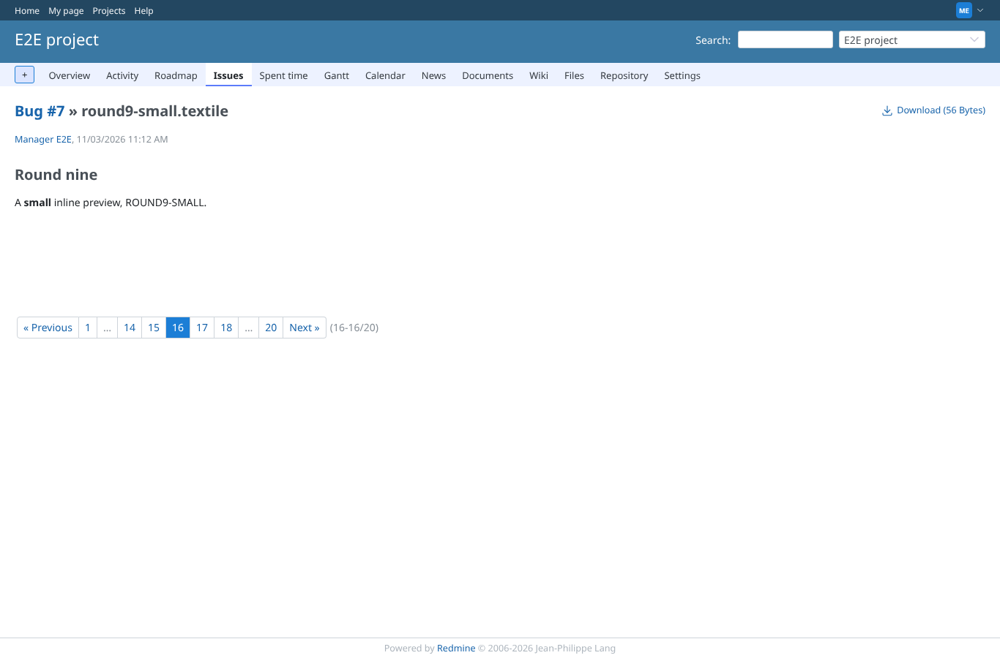
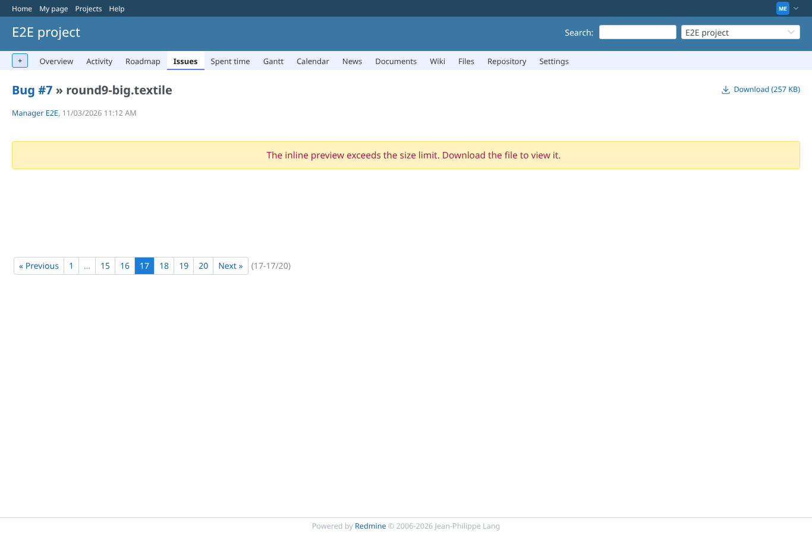
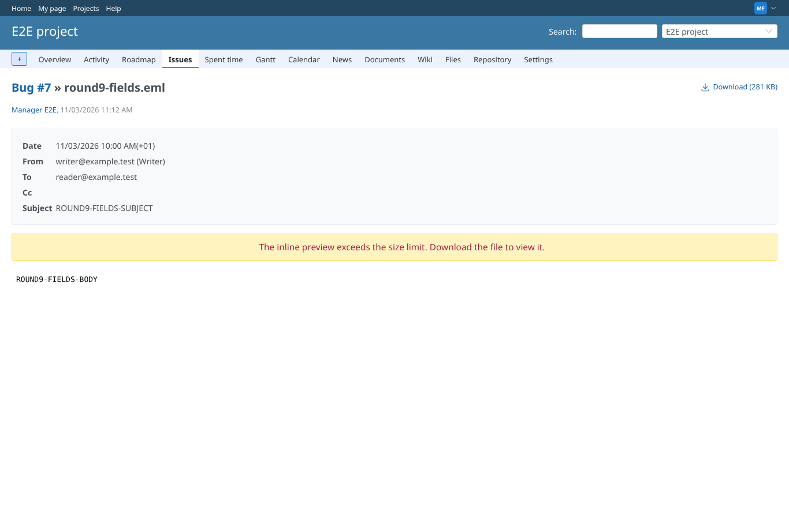
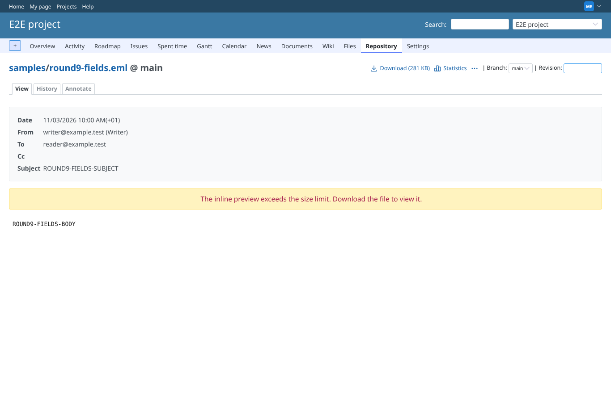
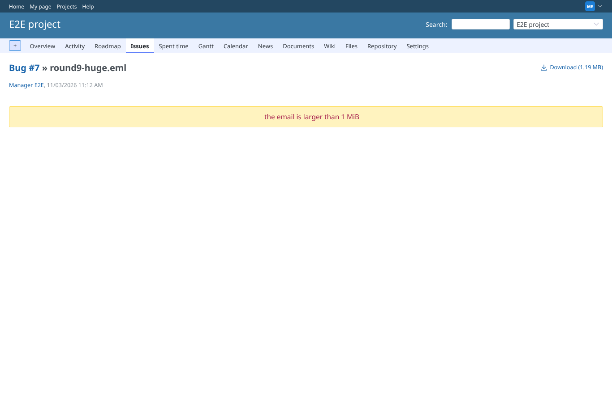
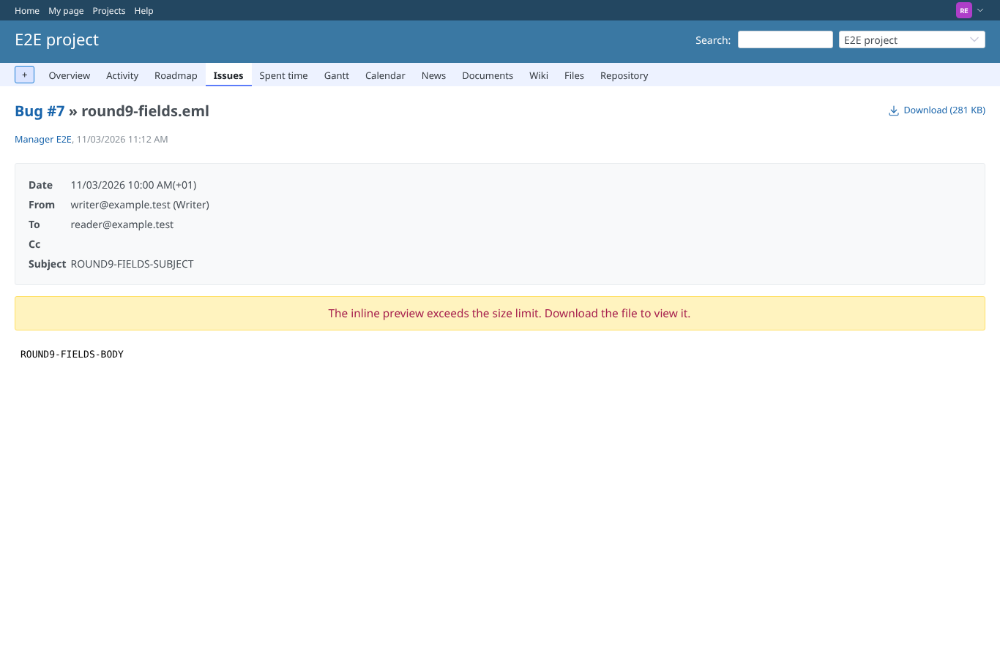
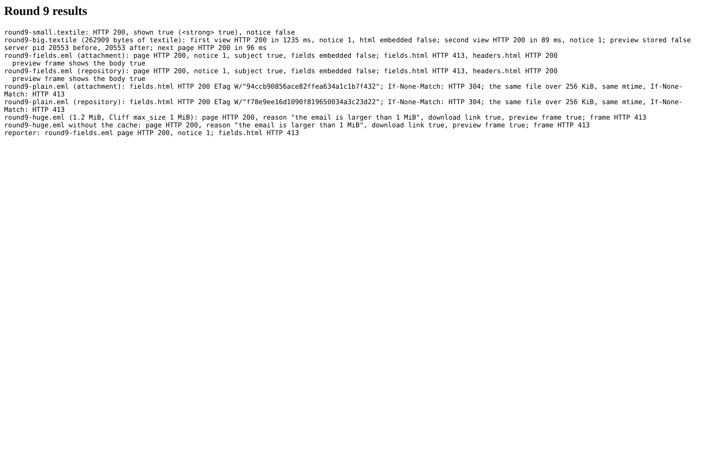

# round9

Run 2026-11-03T11:13:24.013Z against http://127.0.0.1:3000.

| screenshot | user | URL | shows |
|---|---|---|---|
|  | manager | `/attachments/57` | round9-small.textile, inline: shown in the page as before |
|  | manager | `/attachments/58` | round9-big.textile, inline: html over 256 KiB, the size notice in the page instead of the preview; page in 1235 ms |
|  | manager | `/attachments/59` | round9-fields.eml (attachment): header fields over 256 KiB, the size notice in place of the folded fields; headers and body shown; fields.html directly HTTP 413 |
|  | manager | `/projects/e2e-project/repository/samples/entry/round9-fields.eml` | round9-fields.eml (repository): header fields over 256 KiB, the size notice in place of the folded fields; headers and body shown; fields.html directly HTTP 413 |
|  | manager | `/attachments/61` | round9-huge.eml (1.2 MiB, Cliff max_size 1 MiB): the attachment page stays, with the reason above the frame (the frame answers 413) |
|  | manager | `/attachments/61` | round9-huge.eml without the cache: the attachment page stays, with the reason above the frame (the frame answers 413) |
|  | reporter | `/attachments/59` | reporter (core Reporter role): the same email, the notice in place of the fields |
|  | reporter | `/attachments/59` | Round 9 results |
